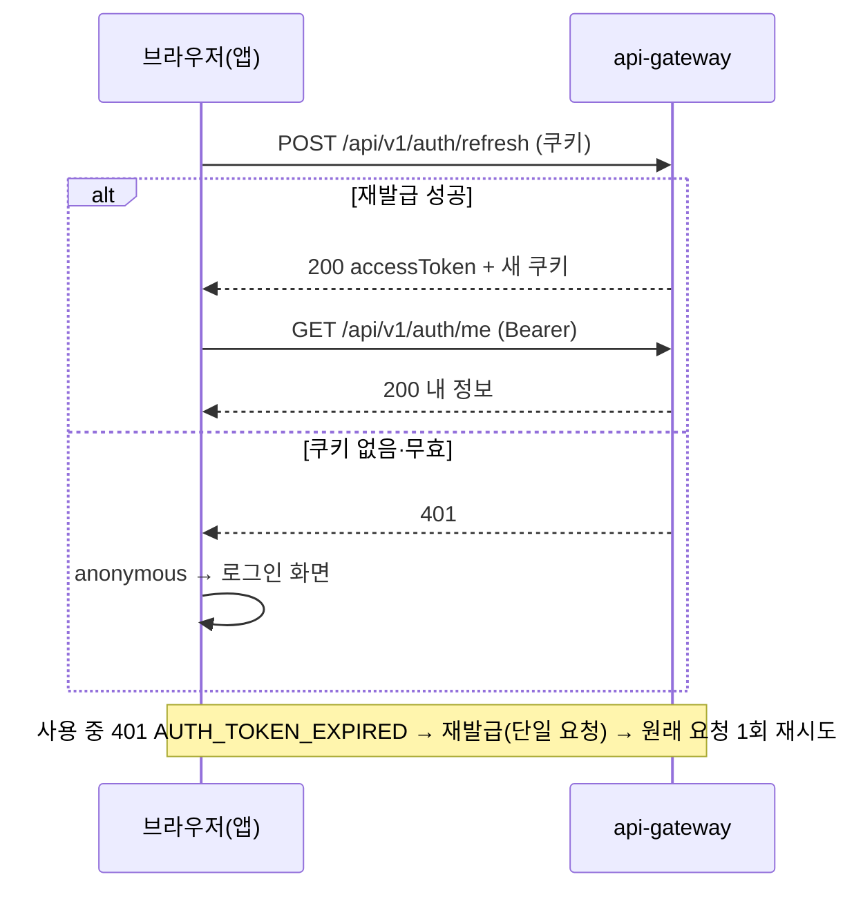

# Plan: SPEC-002 인증 화면과 앱 기본 레이아웃 — frontend

- spec: docs 레포 `docs/specs/SPEC-002-frontend-auth-shell/spec.md`
- 계약: docs 레포 `docs/contracts/openapi/auth-service.yaml`(1.0.1), `docs/contracts/openapi/_common.yaml`(1.2.0)
- ADR: docs 레포 `docs/adr/0004-browser-token-storage.md` (ADR-0004 브라우저 토큰 보관 방식)

## 1. 요약

가입·로그인 화면, 로그인 유지(앱 시작 시 재발급, 만료 시 재발급 후 재시도), 사용자 메뉴와 로그아웃, 사이드바·상단 바 레이아웃과 메뉴 화면을 만든다. 접근 토큰은 메모리에만 두고 재발급 토큰은 HttpOnly 쿠키를 그대로 쓴다(ADR-0004). API는 api-gateway를 직접 호출하고(`VITE_API_BASE_URL`), 요청·응답 타입은 계약에서 생성한 타입을 쓴다. 디자인은 "AI 안전 관제" 다크 테마 시안을 Tailwind `@theme` 토큰으로 옮긴다.

## 2. 담당 요구사항

| 요구사항 | 담당 모듈 / 컴포넌트 | 검증 테스트 |
| --- | --- | --- |
| R-1 | `features/auth` `SignUpForm`, `pages/SignUpPage`, `pages/LogInPage` | `SignUpForm.test.tsx`, `LogInPage.test.tsx` |
| R-2 | `features/auth/model/schemas.ts`, `SignUpForm` | `schemas.test.ts`, `SignUpForm.test.tsx` |
| R-3 | `SignUpForm` | `SignUpForm.test.tsx` |
| R-4 | `LogInForm`, `app/layout/TopBar` | `LogInFlow.test.tsx` |
| R-5, R-6 | `LogInForm`, `shared/lib/messages.ts` | `LogInForm.test.tsx` |
| R-7 | `features/auth` `RequireAuth`, `LogInPage` | `RequireAuth.test.tsx` |
| R-8 | `shared/api/session.ts`, `features/auth` `SessionBootstrap` | `SessionBootstrap.test.tsx` |
| R-9 | `shared/api/client.ts` | `client.test.ts` |
| R-10 | `shared/api/client.ts`, `RequireAuth` | `client.test.ts`, `RequireAuth.test.tsx` |
| R-11 | `features/auth` `UserMenu` | `UserMenu.test.tsx` |
| R-12 | `UserMenu`, `features/auth/api` | `UserMenu.test.tsx` |
| R-13, R-14 | `app/layout/AppLayout`, `Sidebar`, `TopBar` | `AppLayout.test.tsx` |
| R-15 | `pages/ComingSoonPage` | `ComingSoonPage.test.tsx` |
| R-16 | `pages/AnalysisPage` | `AnalysisPage.test.tsx` |
| NFR-1 | `shared/api/session.ts` | `session.test.ts`(저장소·쿠키에 토큰 없음) |
| NFR-2 | 모든 화면 | `Keyboard.test.tsx`(Tab 순서, Enter·Escape 조작) |
| NFR-3 | `shared/lib/messages.ts`, `shared/api/problem.ts` | `messages.test.ts`, `problem.test.ts` |
| NFR-4, NFR-5 | `AppLayout`, 인증 화면 | Playwright `responsive.spec.ts`(360px 가로 스크롤 없음, 1024px 미만 메뉴 버튼) |

## 3. 원칙 점검

| 원칙 | 준수 | 비고 |
| --- | --- | --- |
| I 스펙 우선 — spec이 Approved 상태인가 | ☑ | docs #16 |
| II 계약 우선 — 계약 변경이 먼저 머지됐는가 | ☑ | 계약 변경 없음. 생성 타입이 계약과 같은지 CI가 확인한다 |
| III 테스트 우선 — 모든 R-*에 테스트가 매핑되고, 태스크가 요구사항 단위 TDD 사이클로 나뉘었는가 | ☑ | 2절, tasks.md |
| IV 서비스 자율성 — 다른 서비스 DB나 코드에 직접 의존하지 않는가 | ☑ | api-gateway HTTP API만 쓴다 |
| V 단순성 — 새 의존성이나 추상화가 정당한가 | ☑ | 새 의존성 2개(사용자 승인): `lucide-react`(아이콘), `pretendard`(글꼴). 세션 상태는 Zustand 없이 `useSyncExternalStore`로 둔다 |
| VI 관측 가능성 — 로그, 추적, health를 갖췄는가 | ☑ | 오류 화면에 ProblemDetail `traceId`를 보이지 않고, 개발자 도구용으로만 둔다. 브라우저 로그(`console`)는 쓰지 않는다 |
| VII 보안 — 입력 검증, 인가, 비밀값 처리를 했는가 | ☑ | 폼은 Zod로 검증, 로그인 후 이동 주소(`redirect`)는 앱 내부 경로만 허용, 토큰은 메모리에만(ADR-0004) |
| VIII 문서·주석 — spec·계약·plan과 구현이 일치하고, 주석이 왜를 설명하는가 | ☑ | |
| IX GitOps — AWS 변경은 infra, 클러스터 변경은 gitops 레포를 거치는가 | ☑ | 해당 없음(배포는 별도) |

## 4. 기술 설계

### 변경 대상

| 경로 | 변경 |
| --- | --- |
| `src/app/index.css` | 디자인 토큰(`@theme`), Pretendard |
| `src/app/{App,router,providers}.tsx` | QueryClient, 라우터(화면 단위 `lazy`), 세션 시작 |
| `src/app/layout/` | `AppLayout`, `Sidebar`, `TopBar`, `MobileNavButton` |
| `src/shared/api/` | `client.ts`(기본 주소, 인증 헤더, 재발급 후 재시도), `session.ts`(메모리 토큰, 재발급 단일 요청, 상태 구독), `problem.ts`(ProblemDetail → `ApiError`) |
| `src/shared/lib/messages.ts` | 오류 `code` → 한국어 문구, 공통 문구 |
| `src/shared/ui/` | `Button`, `TextField`, `Spinner` |
| `src/features/auth/` | `model/schemas.ts`, `api/`(가입·로그인·내 정보·로그아웃 훅), `components/`(`SignUpForm`, `LogInForm`, `UserMenu`, `RequireAuth`, `SessionBootstrap`), `index.ts` |
| `src/pages/` | `LogInPage`, `SignUpPage`, `AnalysisPage`, `ComingSoonPage` |
| `mocks/handlers.ts`, `tests/` | MSW 핸들러, 테스트 렌더 도우미, Playwright 시나리오 |
| `.env.example`, `README.md` | `VITE_API_BASE_URL`, 실행 방법 |

### 화면과 경로

| 경로 | 화면 | 접근 |
| --- | --- | --- |
| `/login` | 로그인 | 로그인 상태면 `/analysis`로 |
| `/signup` | 가입 | 로그인 상태면 `/analysis`로 |
| `/` | `/analysis`로 이동 | 로그인 필요 |
| `/analysis` | 영상 분석(빈 화면, R-16) | 로그인 필요 |
| `/events`, `/search`, `/history`, `/settings` | 준비 중(R-15) | 로그인 필요 |

- 로그인 필요 경로에 로그아웃 상태로 오면 `/login?redirect=<원래 경로>`로 보낸다(R-7). `redirect`는 `/`로 시작하고 `//`로 시작하지 않는 값만 받는다(외부 주소로 보내는 공격 방지).
- 가입에 성공하면 `/login`으로 보내면서 라우터 state로 이메일과 "가입 완료" 표시를 넘긴다(R-1).

### 세션과 API 클라이언트 (ADR-0004)

- `session.ts`가 접근 토큰과 세션 상태(`checking`, `authenticated`, `anonymous`)를 모듈 메모리에 둔다. 컴포넌트는 `useSyncExternalStore`로 구독한다.
- `refreshSession()`은 진행 중인 재발급이 있으면 그 Promise를 돌려준다(단일 요청). 재발급 토큰이 회전하므로 동시에 두 번 보내면 재사용으로 감지되어 로그인이 끊긴다. React StrictMode의 이중 실행도 이 방식으로 막는다.
- 앱이 시작되면 `SessionBootstrap`이 `refreshSession()`을 한 번 호출한다(R-8). 성공하면 `authenticated`, 실패하면 `anonymous`다. `checking` 동안에는 로딩 표시만 한다.
- `client.ts`의 `apiRequest`
  - 기본 주소는 `import.meta.env.VITE_API_BASE_URL`이다. 쿠키가 필요한 요청(로그인, 재발급, 로그아웃)과 인증 요청 모두 `credentials: "include"`로 보낸다.
  - 접근 토큰이 있으면 `Authorization: Bearer`를 붙인다.
  - 응답이 401 `AUTH_TOKEN_EXPIRED`면 `refreshSession()` 뒤 같은 요청을 한 번 다시 보낸다(R-9). 재발급이 실패하면 세션을 `anonymous`로 바꾼다. `RequireAuth`가 이를 보고 로그인 화면으로 보낸다(R-10).
  - 오류 응답은 `problem.ts`가 `ApiError(status, code, fieldErrors)`로 바꾼다. 본문이 ProblemDetail이 아니면 `code`는 없다.
- 로그아웃은 서버 요청이 실패해도 메모리 토큰과 Query 캐시를 지우고 로그인 화면으로 보낸다(R-12).
- 내 정보는 TanStack Query `useMe()`로 가져온다. query key는 `authQueryKeys.me()`다. 세션이 `anonymous`가 되면 캐시를 지운다.

### 오류 문구 (NFR-3)

| code | 문구 |
| --- | --- |
| `AUTH_EMAIL_DUPLICATED` | 이미 가입된 이메일입니다. |
| `AUTH_INVALID_CREDENTIALS` | 이메일 또는 비밀번호가 올바르지 않습니다. |
| `AUTH_ACCOUNT_LOCKED` | 로그인 시도가 너무 많습니다. 잠시 후 다시 시도해 주세요. |
| `GATEWAY_RATE_LIMITED` | 요청이 너무 많습니다. 잠시 후 다시 시도해 주세요. |
| `AUTH_PASSWORD_POLICY`, `AUTH_INVALID_REQUEST` | 입력값을 확인해 주세요. (필드 오류가 있으면 칸 옆에 표시) |
| 그 밖의 code, 네트워크 오류 | 요청을 처리하지 못했습니다. 잠시 후 다시 시도해 주세요. |

### 레이아웃과 디자인 토큰

- 시안의 색을 `@theme` 토큰으로 둔다: 배경 `surface`(#0b1220), 패널 `panel`(#111a2b), 선 `line`(#1f2b40), 본문 `content`(#e6edf5), 보조 `muted`(#8a9ab3), 강조 `accent`(#2ec4cf), 경고 `warning`(#f5a524), 위험 `danger`(#ef4444).
- 글꼴은 Pretendard 가변 글꼴 dynamic subset을 앱에 포함한다(외부 CDN 없음).
- 1024px 이상: 왼쪽 고정 사이드바(아이콘 + 이름), 상단 바(서비스 이름, 사용자 메뉴). 1024px 미만: 사이드바를 숨기고 상단 바의 메뉴 버튼으로 여는 서랍(drawer)으로 쓴다(NFR-5). 서랍은 Escape와 바깥 클릭으로 닫는다.
- 사이드바 메뉴: 영상 분석(`/analysis`), 이벤트(`/events`), 검색(`/search`), 분석 이력(`/history`)과 맨 아래 설정(`/settings`). 현재 메뉴는 `aria-current="page"`와 강조색으로 표시한다(R-14).
- 영상 분석 빈 화면에는 "아직 분석한 영상이 없습니다" 안내와 비활성화한 "영상 업로드" 버튼을 둔다.

### 데이터 모델

해당 없음(frontend).

### API / 이벤트

`signUp`, `logIn`, `refreshToken`, `logOut`, `getMe` (`auth-service.yaml` 1.0.1). 타입은 `src/api/generated/auth-service.ts`를 쓴다.

### 상호작용

## 5. 대안과 선택 이유

| 대안 | 장점 | 단점 | 선택 |
| --- | --- | --- | --- |
| 게이트웨이 직접 호출(`VITE_API_BASE_URL=http://localhost:8080`) | 운영과 같은 교차 출처 구성을 개발에서도 확인 | CORS·쿠키 설정에 의존, Safari는 `http://localhost`의 Secure 쿠키를 저장하지 않을 수 있음 | ☑ (사용자 결정) |
| Vite 개발 프록시 | 같은 출처라 CORS·쿠키 문제가 없음 | 운영 구성과 다름 | |
| 세션 상태 `useSyncExternalStore` + 모듈 저장소 | 의존성 없음, API 클라이언트와 React가 같은 상태를 봄 | 직접 구현 | ☑ |
| 세션 상태 Zustand | 익숙한 API | 상태 하나에 의존성 추가 | |
| 아이콘 `lucide-react` | 시안과 비슷한 선형 아이콘, tree-shaking | 의존성 1개 | ☑ (사용자 결정) |
| 글꼴 Pretendard(npm, 앱에 포함) | 시안과 같은 느낌, CDN 의존 없음 | 글꼴 파일 다운로드 | ☑ (사용자 결정) |

## 6. 테스트 전략

- 단위: `schemas.ts`(가입 규칙), `problem.ts`, `messages.ts`, `session.ts`(단일 요청, 저장소 미사용), `client.ts`(인증 헤더, 만료 시 재발급 후 1회 재시도, 재발급 실패 시 anonymous)
- 컴포넌트·흐름: Vitest + Testing Library + MSW(`mocks/handlers.ts`). 라우터와 QueryClient를 감싼 `renderWithProviders`로 화면 흐름을 검증한다. 테스트 이름은 `[SPEC-002 R-n] ...`
- E2E: Playwright. API는 `page.route`로 대신하고, 데스크톱·360px 모바일 프로젝트에서 가입 → 로그인 → 새로고침 → 로그아웃과 반응형(NFR-4, NFR-5)을 확인한다. CI `checks.yml`에 `e2e` job을 추가한다.
- 시연: 로컬 compose(docs `local/`) + `pnpm dev`로 실제 백엔드와 흐름을 확인한다(성공 지표).

## 7. 리스크와 롤백

- 리스크
  - 여러 탭이 거의 동시에 열리면 재발급이 겹쳐 재사용으로 감지될 수 있다(ADR-0004 감수할 점). 다시 로그인하면 된다.
  - Safari 로컬 개발에서 재발급 쿠키가 저장되지 않을 수 있다. Chrome 계열로 개발·시연한다.
- 롤백 방법: 신규 화면이라 이전 커밋으로 되돌리면 된다.

## 8. 배포 고려사항

- 환경변수: 레포 `.env.example`에 `VITE_API_BASE_URL=http://localhost:8080`. 운영 값은 배포 구성을 정할 때 gitops 설정에 둔다. `VITE_` 변수는 브라우저에 노출되므로 비밀값을 넣지 않는다.
- 게이트웨이 `GATEWAY_CORS_ALLOWED_ORIGINS`에 frontend 주소가 있어야 한다(로컬 기본값 `http://localhost:5173`).
- 이미지 빌드·배포 workflow는 이 spec 범위 밖이다.
