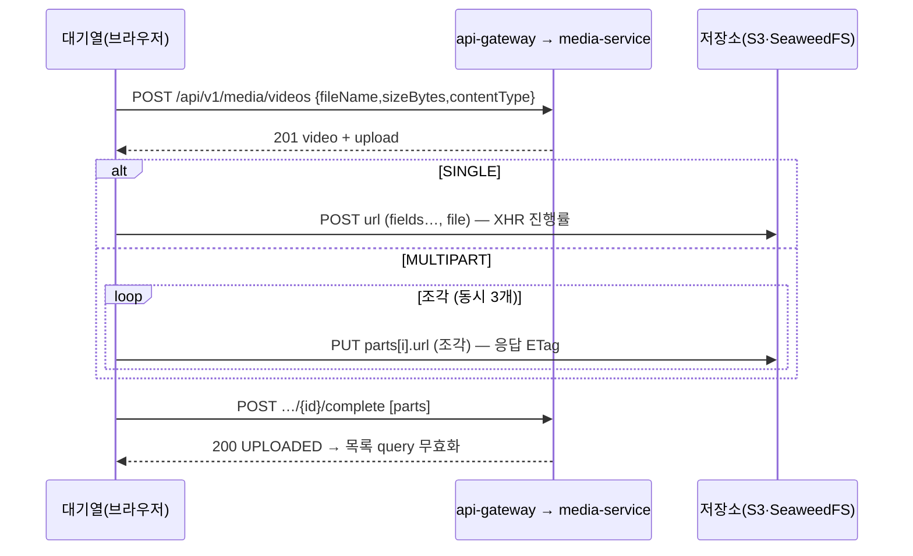

# Plan: SPEC-005 영상 업로드 화면과 내 영상 목록 — frontend

- spec: docs 레포 `docs/specs/SPEC-005-frontend-video-upload/spec.md`
- 계약: docs 레포 `docs/contracts/openapi/media-service.yaml`(1.0.1), `docs/contracts/openapi/_common.yaml`
- 관련: SPEC-003(media-service), SPEC-002(앱 기본 레이아웃, API 클라이언트), ADR-0006(로컬 SeaweedFS)

## 1. 요약

영상 분석 화면(`/analysis`)의 빈 상태를 업로드 대기열과 내 영상 목록으로 바꾼다. 고른 파일은 화면 밖 모듈 저장소의 대기열에 넣고 하나씩 올린다. 업로드 자리 발급·완료·목록·삭제는 api-gateway를 거치는 기존 `apiRequest`로 부르고, 파일 바이트는 media-service가 준 저장소 주소로 `XMLHttpRequest`를 써서 바로 보낸다(진행률 때문). 대기열이 React 밖에 있어서 다른 메뉴로 이동해도 업로드가 이어지고, 화면은 `useSyncExternalStore`로 구독한다. 새 의존성은 없다.

## 2. 담당 요구사항

R-21(로컬 저장소 CORS)은 docs 레포 몫이다. SeaweedFS 기본 설정으로 이미 충족됨을 확인했고(spec 5절), 이 레포에서는 로컬 compose 시연(T021)으로 브라우저 업로드를 다시 확인한다.

경로 약어: `U` = `src/features/upload`

| 요구사항 | 담당 모듈 / 컴포넌트 | 검증 테스트 |
| --- | --- | --- |
| R-1 | `U/components/{UploadButton,UploadDropzone}`, `U/model/uploadQueue` | `UploadDropzone.test.tsx`, `uploadQueue.test.ts` |
| R-2, R-3 | `U/model/fileRules` | `fileRules.test.ts`, `UploadDropzone.test.tsx` |
| R-4 | `U/model/uploadQueue` | `uploadQueue.test.ts` |
| R-5 | `U/api/uploadVideo`, `U/api/storageTransport` | `uploadVideo.test.ts` |
| R-6 | `U/api/uploadVideo`(조각 나누기, 동시 3개) | `uploadVideo.test.ts` |
| R-7 | `U/api/uploadVideo`, `uploadQueue`(완료 시 목록 무효화) | `uploadVideo.test.ts`, `AnalysisUpload.test.tsx` |
| R-8 | `U/components/UploadQueuePanel` | `UploadQueuePanel.test.tsx` |
| R-9 | `U/api/storageTransport`(최대 3번 재전송) | `storageTransport.test.ts` |
| R-10, R-11 | `uploadQueue`, `UploadQueuePanel` | `uploadQueue.test.ts`, `UploadQueuePanel.test.tsx` |
| R-12 | `uploadQueue`(중단 신호, 삭제 요청) | `uploadQueue.test.ts` |
| R-13 | `uploadQueue`(모듈 저장소), `pages/AnalysisPage` | `src/pages/AnalysisUpload.test.tsx`(메뉴 이동 후 복귀) |
| R-14 | `U/hooks/useLeaveWarning` | `useLeaveWarning.test.tsx` |
| R-15 | `U/api/useVideos`, `U/components/VideoList` | `VideoList.test.tsx` |
| R-16, R-17 | `U/model/videoStatus`, `VideoList` | `VideoList.test.tsx` |
| R-18 | `pages/AnalysisPage` | `src/pages/AnalysisPage.test.tsx`(SPEC-002 R-16 테스트를 대체) |
| R-19 | `U/components/DeleteVideoDialog`, `U/api/useDeleteVideo`, `shared/ui/ConfirmDialog` | `DeleteVideoDialog.test.tsx` |
| R-20 | `useDeleteVideo` | `DeleteVideoDialog.test.tsx` |
| NFR-1 | `storageTransport` | `uploadVideo.test.ts`(게이트웨이 주소로 바이트를 보내지 않음) |
| NFR-2 | `storageTransport`, `uploadQueue` | `uploadSecrets.test.ts`(브라우저 저장소·콘솔에 서명 없음) |
| NFR-3 | `shared/lib/messages.ts` | `messages.test.ts` |
| NFR-4 | `storageTransport`(진행 이벤트 전달) | `UploadQueuePanel.test.tsx` |
| NFR-5 | 업로드·목록·확인 창 | `src/app/Keyboard.test.tsx`에 업로드 시나리오 추가, `UploadQueuePanel.test.tsx`(`progressbar`, `status` 영역) |
| NFR-6 | `AnalysisPage`, `VideoList`, `UploadQueuePanel` | Playwright `responsive.spec.ts`(360px) |

## 3. 원칙 점검

| 원칙 | 준수 | 비고 |
| --- | --- | --- |
| I 스펙 우선 — spec이 Approved 상태인가 | ☑ | docs #35 |
| II 계약 우선 — 계약 변경이 먼저 머지됐는가 | ☑ | 계약 변경 없음. `media-service.yaml` 1.0.1에서 타입을 생성하고 CI가 최신인지 확인한다 |
| III 테스트 우선 — 모든 R-*에 테스트가 매핑되고, 태스크가 요구사항 단위 TDD 사이클로 나뉘었는가 | ☑ | 2절, tasks.md |
| IV 서비스 자율성 — 다른 서비스 DB나 코드에 직접 의존하지 않는가 | ☑ | api-gateway API와 media-service가 준 저장소 주소만 쓴다 |
| V 단순성 — 새 의존성이나 추상화가 정당한가 | ☑ | 새 의존성 없음. 진행률은 내장 `XMLHttpRequest`, 대기열은 세션과 같은 모듈 저장소 + `useSyncExternalStore`, 확인 창은 `<dialog>` |
| VI 관측 가능성 — 로그, 추적, health를 갖췄는가 | ☑ | 브라우저 로그(`console`)는 쓰지 않는다(NFR-2) |
| VII 보안 — 입력 검증, 인가, 비밀값 처리를 했는가 | ☑ | 파일 형식·크기 사전 검사, 응답은 Zod로 검증, 서명 주소는 메모리에만 두고 업로드가 끝나면 버린다 |
| VIII 문서·주석 — spec·계약·plan과 구현이 일치하고, 주석이 왜를 설명하는가 | ☑ | |
| IX GitOps — AWS 변경은 infra, 클러스터 변경은 gitops 레포를 거치는가 | ☑ | 해당 없음. 운영 S3 CORS는 infra 몫(spec 5절) |

## 4. 기술 설계

### 변경 대상

| 경로 | 변경 |
| --- | --- |
| `package.json` `gen:api` | `media-service.yaml`도 생성 → `src/api/generated/media-service.ts` |
| `src/shared/lib/messages.ts` | `MEDIA_*` 오류 문구(NFR-3) |
| `src/shared/lib/format.ts` | 파일 크기(KB·MB·GB), 시각(Asia/Seoul) 표시 |
| `src/shared/ui/` | `ProgressBar`, `ConfirmDialog`(`<dialog>`), `Pagination` |
| `src/features/upload/model/` | `schemas.ts`(계약 응답 Zod), `fileRules.ts`(확장자 → 형식, 크기), `videoStatus.ts`(상태 이름), `queryKeys.ts`, `uploadQueue.ts`(대기열 저장소) |
| `src/features/upload/api/` | `mediaApi.ts`(자리 발급·완료·삭제), `storageTransport.ts`(XHR POST·PUT, 진행률, 재시도, 중단), `uploadVideo.ts`(한 파일 업로드 흐름), `useVideos.ts`, `useDeleteVideo.ts` |
| `src/features/upload/hooks/` | `useUploadQueue.ts`(구독), `useLeaveWarning.ts` |
| `src/features/upload/components/` | `UploadButton`(파일 고르기 창), `UploadDropzone`(끌어다 놓기 영역), `UploadQueuePanel`, `VideoList`, `DeleteVideoDialog` |
| `src/shared/api/client.ts` | `RequestOptions.signal`: 업로드 자리 발급·완료 요청도 취소·로그아웃 때 중단한다 |
| `src/pages/AnalysisPage.tsx` | 업로드 버튼 활성화, 대기열, 목록, 빈 상태(R-18) |
| `mocks/handlers.ts`, `tests/` | media API·저장소 MSW 핸들러, E2E 가짜 media API·저장소 |

### 한 파일의 업로드 흐름

- `contentType`은 확장자로 정한다(`mp4` → `video/mp4`, `mov` → `video/quicktime`, `mkv` → `video/x-matroska`, `avi` → `video/x-msvideo`). 브라우저의 `File.type`은 mkv·avi에서 비어 있거나 다를 수 있어서 쓰지 않는다. 대소문자는 구분하지 않는다.
- 크기 검사는 `1 ≤ size ≤ 5,368,709,120`(R-3). 형식·크기가 틀린 파일은 대기열에 "거절" 항목으로만 보이고 요청하지 않는다(R-2, R-3).
- 조각은 `File.slice`로 `partSizeBytes`씩 자른다. 조각을 동시에 3개까지 보낸다. 한 조각씩 보내면 지연 시간 때문에 대역폭을 다 쓰지 못하고, 너무 많이 보내면 브라우저의 호스트당 연결 수(6)를 업로드가 독차지한다.
- 단일 업로드 폼은 `fields`를 응답 순서대로 넣고 `file`을 마지막에 넣는다(S3 POST 정책 규칙).
- 진행률은 XHR `upload.onprogress`의 바이트를 합쳐 파일 전체 비율로 계산한다. 재시도한 조각은 그 조각의 진행분을 0부터 다시 센다.
- 업로드 자리 발급·완료·삭제는 `apiRequest`를 써서 접근 토큰 만료 시 재발급 후 재시도(SPEC-002 R-9)를 그대로 받는다. 저장소 요청에는 `Authorization` 헤더와 쿠키를 붙이지 않는다.

### 재시도·실패·취소

- 재시도(R-9): 저장소 요청이 네트워크 오류(`onerror`, `ontimeout`)나 5xx로 끝나면 1초, 2초, 4초 뒤 최대 3번 다시 보낸다. 4xx(서명 만료, 크기 불일치 등)는 다시 보내도 같은 결과라 재시도하지 않는다.
- 실패(R-10): 재시도까지 실패하거나 자리 발급·완료가 실패하면 항목을 `failed`로 바꾸고 오류 `code`의 문구를 보여 준 뒤 다음 파일로 넘어간다. 저장소 실패는 `code`가 없으므로 "업로드 중 연결이 끊겼습니다" 문구를 쓴다.
- 다시 시도(R-11): 실패 항목을 대기열 끝에 다시 넣고 새 자리를 받는다. 이전 영상은 `UPLOADING`으로 남아 24시간 뒤 만료되므로 따로 지우지 않는다.
- 취소(R-12): 항목마다 `AbortController`를 두고, 진행 중인 XHR을 `abort()`한다. 이미 자리를 받았으면 `DELETE …/videos/{id}`를 보낸다. 삭제가 실패해도 대기열에서는 빼고(만료로 정리됨) 목록을 다시 불러온다.

### 대기열 저장소 (`uploadQueue.ts`)

- 항목: `{ localId, file, status: waiting | uploading | completing | done | failed | rejected | canceled, progress, videoId?, errorMessage? }`. 서명 주소와 폼 값은 항목에 두지 않고 업로드 함수 안의 지역 값으로만 쓴다(NFR-2).
- `add(files)`, `cancel(localId)`, `retry(localId)`, `dismiss(localId)`, `subscribe`, `getSnapshot`. 하나가 끝나면 다음 `waiting`을 시작한다(R-4).
- React 밖 모듈이라 라우트가 바뀌어도 업로드가 계속된다(R-13). 완료 시 `queryClient.invalidateQueries(videoQueryKeys.all)`을 부르도록 `AppProviders`가 `onVideoUploaded` 콜백을 등록한다(서버 데이터를 저장소에 복사하지 않는다).
- 로그아웃하면(`subscribeSession`이 `anonymous`) 진행 중 업로드를 중단하고 대기열을 비운다. 다른 사용자가 같은 탭에서 로그인했을 때 이전 사용자의 업로드가 이어지지 않게 한다.
- `done` 항목은 목록에 나타나면(같은 `videoId`) 대기열에서 자동으로 뺀다. `failed`·`rejected`는 사용자가 닫을 때까지 둔다.

### 화면

- `AnalysisPage`: 제목 줄에 "영상 업로드" 버튼(숨긴 `<input type="file" multiple accept=".mp4,.mov,.mkv,.avi">`를 연다). 페이지 영역 전체가 끌어다 놓기 대상이고, 끌고 있을 때 안내 테두리를 보인다. 그 아래 대기열 패널(항목이 있을 때만), 그 아래 내 영상 목록.
- `UploadQueuePanel`: 항목마다 파일 이름, 크기, `role="progressbar"`(`aria-valuenow`), 상태 문구, 취소·다시 시도·닫기 버튼. 완료·실패 알림은 `role="status"` 영역에 한 줄로 읽힌다(NFR-5).
- `VideoList`: 데스크톱은 표(파일 이름, 크기, 상태, 올린 시각, 삭제), 1024px 미만은 카드 목록. 20개씩, 이전·다음 버튼과 "n / m 쪽". 페이지 번호는 URL `?page=`(Zod로 0 이상 정수만 받음)에 둔다.
- 상태 이름(R-16): `UPLOADING` 업로드 중, `UPLOADED` 업로드 완료, `EXPIRED` 만료됨, `NORMALIZING` 변환 중, `READY` 분석 준비됨, `REJECTED` 처리 불가.
- R-17: `UPLOADING`인데 대기열에 같은 `videoId`가 없으면 "업로드가 끝나지 않았습니다. 24시간 뒤 자동으로 지워집니다"를 함께 보인다.
- R-18: 목록이 비어 있고 대기열도 비어 있으면 기존 `EmptyState`에 "올린 영상이 없습니다"와 업로드 버튼.
- `DeleteVideoDialog`: `ConfirmDialog`(`<dialog>` + `showModal()`, Escape로 닫힘)에 파일 이름을 보여 준다. 확인 → `DELETE` → 목록 무효화. 404면 R-20 안내 후 무효화.
- `useLeaveWarning`: 대기열에 `waiting`·`uploading`·`completing`이 있는 동안만 `beforeunload`를 등록한다(R-14). 앱 안 이동은 막지 않는다.

### 데이터 모델

해당 없음(frontend). 대기열은 메모리에만 있다.

### API

`createVideo`, `completeVideoUpload`, `listVideos`, `deleteVideo` (`media-service.yaml` 1.0.1). 응답은 생성 타입에 `satisfies`한 Zod 스키마로 검증한다(`UploadInstruction`은 `method`로 나눈 `z.discriminatedUnion`). `getVideo`는 쓰지 않는다(상세 화면 없음).

## 5. 대안과 선택 이유

| 대안 | 장점 | 단점 | 선택 |
| --- | --- | --- | --- |
| 저장소 업로드에 `XMLHttpRequest` | 업로드 진행률 이벤트, `abort()` | 콜백 API를 Promise로 감싸야 함 | ☑ |
| `fetch` | 기존 클라이언트와 같은 API | 업로드 진행률을 받을 수 없음(요청 스트림 진행률은 Chromium 일부만) | |
| 업로드 라이브러리(Uppy 등) | 재시도·이어 올리기 내장 | 큰 의존성, 서명 방식(POST 정책 + 조각 PUT)에 맞추려면 어댑터 필요 | |
| 대기열을 모듈 저장소 + `useSyncExternalStore` | 의존성 없음, 라우트와 무관하게 유지, 세션과 같은 방식 | 직접 구현 | ☑ |
| 대기열을 Zustand | 익숙한 API | 상태 하나에 의존성 추가 | |
| 조각 동시 3개 | 대역폭 활용, 연결 여유 | 순차보다 진행률 계산이 조금 복잡 | ☑ |
| 조각 순차 | 단순 | 큰 파일에서 느림 | |
| 확인 창 `<dialog>` | 내장 모달(포커스 가두기, Escape) | 스타일을 직접 | ☑ |

## 6. 테스트 전략

- 단위: `fileRules`(확장자·크기·contentType), `storageTransport`(진행률, 5xx·네트워크 오류 재시도 3번, 4xx 즉시 실패, 중단), `uploadVideo`(단일 폼 순서, 조각 크기·ETag 수집·완료 본문, 게이트웨이로 바이트 미전송), `uploadQueue`(순서, 하나씩, 실패 후 다음, 다시 시도, 취소 시 삭제 요청, 로그아웃 시 비움), `messages`.
- XHR은 MSW(node)가 가로챈다. 진행률 이벤트가 필요한 테스트는 `storageTransport`에 XHR 생성 함수를 넘겨 가짜 XHR로 검증한다(내부 상태 대신 콜백 결과를 본다).
- 컴포넌트·흐름: Testing Library + MSW. `[SPEC-005 R-n] ...` 이름. 파일 고르기는 `userEvent.upload`.
- E2E(Playwright): `fakeApi.ts`에 media API와 가짜 저장소(`page.route`로 `http://localhost:8333/**`)를 더해 P1 흐름(단일·멀티파트 업로드 → 목록 → 삭제)과 360px 표시를 확인한다. 멀티파트는 E2E에서 작은 `partSizeBytes`를 응답해 작은 파일로 확인한다.
- 시연: 로컬 compose + `pnpm dev`로 실제 SeaweedFS에 1MB·110MB 업로드, Kafka `video.uploaded` 확인(성공 지표, R-21).

## 7. 리스크와 롤백

- 리스크
  - 5GB 파일을 올리는 동안 접근 토큰(15분)이 만료돼도 저장소 요청은 서명 주소라 영향이 없고, 완료 요청은 재발급 후 재시도된다. 서명 주소 유효시간(1시간)을 넘기는 아주 느린 업로드는 4xx로 실패하고 "다시 시도"로 처음부터 올린다.
  - 탭이 백그라운드로 가면 브라우저가 타이머를 늦추지만 XHR 전송은 계속된다. 재시도 대기만 길어질 수 있다.
  - 운영 S3에 CORS가 없으면 브라우저 업로드가 막힌다. infra 작업(spec 5절) 전에는 운영에서 쓸 수 없다.
- 롤백 방법: 기존 빈 화면으로 되돌리면 된다(백엔드 변경 없음).

## 8. 배포 고려사항

- 새 환경변수 없음. 저장소 주소는 media-service 응답에서 받는다.
- nginx(`docker/nginx.conf`)에는 CSP 헤더가 없어 저장소 주소를 따로 허용할 필요가 없다. 나중에 CSP를 넣으면 `connect-src`에 저장소 주소(로컬 `http://localhost:8333`, 운영 S3)를 넣어야 한다.
- 운영 S3 버킷 CORS: 허용 Origin = 운영 frontend 주소, 메서드 POST·PUT, `ExposeHeaders: ETag`(infra).
