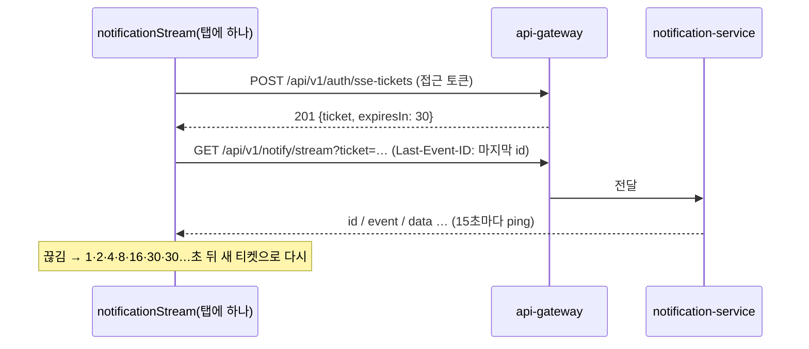

# Plan: SPEC-031 분석 결과 화면(이벤트 타임라인·위험 상태·요약)과 실시간 알림 — frontend

- spec: docs 레포 `docs/specs/SPEC-031-frontend-analysis-results/spec.md`
- 계약: docs 레포 `service-contracts/` 묶음 4.1.0(`service-contracts.lock`)
  - `openapi/analysis-service.yaml` 0.4.0: `listSourceEvents`, `listMyEvents`, `getEvent`, `reviewEvent`, `listSourceRisks`, `listSourceSnapshots`, `getSourceSummary`
  - `openapi/notification-service.yaml` 0.1.0: `subscribeNotifications`
  - `notifications/v1/notification-message.schema.json`: SSE 메시지 `data`
  - `openapi/auth-service.yaml`: `issueSseTicket`
  - `events/_vlm-analysis.schema.json`, `events/_risk-forecast.schema.json`: 응답 안의 `analysis`·`forecast` 형식
- 관련: SPEC-002(레이아웃, API 클라이언트, 세션), SPEC-005·SPEC-006(영상 목록·상세·원본 플레이어), SPEC-032~SPEC-035(이 plan의 T001·알림 연결·플레이어 컨트롤을 그대로 쓴다)

- v5.1(계약 묶음 4.0.0, 2026-11-07, ADR-0015): `openapi/stream-service.yaml` 1.0.0(세션 조회 `getSession`, `state`·`events`·`alerts`), 알림 메시지 종류 `alert.raised`·`state.updated`(생산자 notification-service 확인 필요), analysis 요약의 `partial`·`missingCounts`·`revision`과 이벤트의 `unverifiedReason`(생산자 analysis-api 확인 필요)이 더해졌다. R-19(실시간 세션 화면)·R-20(긴급 알림)·R-21(`state.updated` 순서 적용)·R-22(일부 누락 표시)·R-23(예산·상한 초과 표시)를 아래 설계 절대로 더한다. T001의 lock은 4.1.0(경계 박스 범위·stitched 쌍·예측 빈 구간 수정 포함)이고 `gen:api`에 `stream-service`까지 한 번에 더한다.

## 1. 요약

영상 상세 화면(`/analysis/videos/:videoId`)의 플레이어 아래에 분석 결과(요약, 이벤트 목록·상세, 위험, 스냅샷, 진행률)를 붙이고, "이벤트" 메뉴(`/events`)에 내 영상 전체 이벤트 목록을 만든다. 플레이어는 `upload`에서 `player` feature로 옮기고, 이벤트 위치를 진행 막대에 그리려고 브라우저 기본 컨트롤 대신 자체 컨트롤을 둔다. 실시간 알림은 로그인한 동안 탭마다 연결 하나를 모듈 저장소에 열어 두고 화면은 구독만 한다. 브라우저 `EventSource`는 새 연결에 `Last-Event-ID` 헤더를 넣을 수 없어 `fetch` 스트림과 직접 만든 작은 SSE 해석기를 기본안으로 둔다(사용자 확인 필요, 5절). analysis·notification은 다른 담당자 서비스라 아직 구현이 없으므로, 테스트와 화면 개발은 계약 예시로 응답하는 MSW로 한다.

이 plan의 T001(계약 lock 4.1.0과 생성 코드 다시 만들기)은 SPEC-032~SPEC-035 구현의 첫 단계이기도 하다. 나머지 네 plan은 SPEC-031 T001 완료에 의존한다.

## 2. 담당 요구사항

경로 약어: `A` = `src/features/analysis`, `N` = `src/features/notifications`, `P` = `src/features/player`, `U` = `src/features/upload`, `S` = `src/features/stream`

| 요구사항 | 담당 모듈 / 컴포넌트 | 검증 테스트 |
| --- | --- | --- |
| R-1 | `A/components/AnalysisResults`, `A/api/useSourceSummary`, `src/pages/VideoDetailPage` | `A/components/AnalysisResults.test.tsx`, `src/pages/VideoDetailFlow.test.tsx` |
| R-2 | `A/components/SummaryPanel` | `SummaryPanel.test.tsx` |
| R-3 | `A/components/EventList`, `A/components/EventFilters`, `A/api/useSourceEvents` | `EventList.test.tsx` |
| R-4 | `P/components/PlayerControls`(진행 막대·표시), `A/model/timelineMarkers` | `PlayerControls.test.tsx`, `timelineMarkers.test.ts` |
| R-5 | `A/components/EventDetailPanel`, `A/api/useEvent`, `P/hooks/usePlayerController` | `EventDetailPanel.test.tsx`, `AnalysisResults.test.tsx`(누르면 이동) |
| R-6 | `A/model/verification` | `verification.test.ts`, `EventList.test.tsx` |
| R-7 | `A/components/EventReviewForm`, `A/api/useReviewEvent`, auth `useHasRole` | `EventReviewForm.test.tsx` |
| R-8 | `A/components/RiskPanel`, `A/api/useSourceRisks` | `RiskPanel.test.tsx` |
| R-9 | `A/components/RiskForecast` | `RiskPanel.test.tsx` |
| R-10 | `A/components/SnapshotList`, `A/api/useSourceSnapshots` | `SnapshotList.test.tsx` |
| R-11 | `A/components/AllEventsList`, `A/api/useMyEvents`, `src/pages/EventsPage` | `AllEventsList.test.tsx`, `src/pages/EventsFlow.test.tsx` |
| R-12 | `N/model/notificationStream`, `N/model/parseSse`, `N/api/sseTicket`, `N/hooks/useNotification` | `notificationStream.test.ts`, `useNotification.test.tsx` |
| R-13 | `N/model/notificationStream`(재연결, 이어 받기) | `notificationStream.test.ts` |
| R-14 | `N/model/notificationStream`(세션 구독) | `notificationStream.test.ts` |
| R-15 | `A/components/AnalysisProgress` | `AnalysisProgress.test.tsx` |
| R-16 | `A/hooks/useAnalysisLiveRefresh` | `AnalysisResults.test.tsx` |
| R-17 | `AnalysisResults`, `src/shared/lib/messages.ts` | `AnalysisResults.test.tsx`, `messages.test.ts` |
| R-18 | `EventList`, `RiskPanel`, `A/components/SeverityBadge` | `src/app/Keyboard.test.tsx`에 분석 결과 시나리오 추가, `SeverityBadge.test.tsx` |
| R-19 | `S/api/streamApi.ts`, `S/hooks/useLiveSession`(세션·state·events·alerts, 10초 폴링), `src/pages/StreamSessionPage.tsx`(`/stream/sessions/:sessionId`), `A/components/AnalysisResults`(데이터 출처를 props로 받음) | `useLiveSession.test.tsx`, `StreamSessionPage.test.tsx`(LIVE면 stream API, CLOSED면 analysis API) |
| R-20 | `N/model/schemas.ts`(`alert.raised`), `S/model/alertFeed.ts`(candidateId별 상태 전이), `S/components/AlertBanner`(앱 상단) | `alertFeed.test.ts`, `AlertBanner.test.tsx`(수신 2초 안 표시, pending → confirmed → dismissed) |
| R-21 | `N/model/schemas.ts`(`state.updated`), `S/model/applyStateUpdate.ts`(sequence 비교, 작은 값 버림), `S/components/LiveRiskPanel` | `applyStateUpdate.test.ts`, `LiveRiskPanel.test.tsx` |
| R-22 | `A/components/SummaryPanel`(`partial`·`missingCounts`) | `SummaryPanel.test.tsx` |
| R-23 | `A/model/eventFilters.ts`(`unverifiedReason` 집계), `A/components/SummaryPanel`(재분석 안내) | `eventFilters.test.ts`, `SummaryPanel.test.tsx` |
| NFR-1 | `EventList`, `PlayerControls` | Playwright `analysis-results.spec.ts`(이벤트 500개 응답 뒤 300ms) |
| NFR-2 | `notificationStream`(모듈 하나) | `useNotification.test.tsx`(구독 화면 3개, 연결 요청 1번) |
| NFR-3 | `sseTicket`, `notificationStream`, 서명 주소를 쓰는 `` | `N/model/notificationSecrets.test.ts`, `A/api/analysisSecrets.test.tsx` |

## 3. 원칙 점검

| 원칙 | 준수 | 비고 |
| --- | --- | --- |
| I 스펙 우선 — spec이 Approved 상태인가 | ☑ | docs #126 |
| II 계약 우선 — 계약 변경이 먼저 머지됐는가 | ☑ | analysis 0.3.0·notification 0.1.0은 docs #126로 머지됨. lock을 4.0.0으로 올리고 `pnpm gen:api`로 생성한다(T001). SSE 메시지 형식은 OpenAPI가 참조하지 않아 생성되지 않는다(4절 "API / 이벤트") |
| III 테스트 우선 — 모든 R-*에 테스트가 매핑되고, 태스크가 요구사항 단위 TDD 사이클로 나뉘었는가 | ☑ | 2절, tasks.md |
| IV 서비스 자율성 — 다른 서비스 DB나 코드에 직접 의존하지 않는가 | ☑ | api-gateway 경유 API와 SSE만 쓴다 |
| V 단순성 — 새 의존성이나 추상화가 정당한가 | ☑ | 새 의존성 없음. SSE는 `fetch` 스트림 + 해석기 약 60줄, 플레이어 컨트롤은 기본 `<button>`·`<input type="range">`. 선택지는 5절(사용자 확인 필요) |
| VI 관측 가능성 — 로그, 추적, health를 갖췄는가 | ☑ | 브라우저 로그(`console`)는 쓰지 않는다(NFR-3). 알림 연결 상태(연결 중·끊김·재연결 대기)는 화면에 작은 표시로 보인다 |
| VII 보안 — 입력 검증, 인가, 비밀값 처리를 했는가 | ☑ | URL 파라미터(`event`, `t`, 거르기 값)는 Zod로 검증, 응답은 Zod로 검증. SSE 티켓과 서명 주소는 메모리에만 둔다. 확인·기각 버튼은 OPERATOR에게만 보이고 서버도 403으로 막는다 |
| VIII 문서·주석 — spec·계약·plan과 구현이 일치하고, 주석이 왜를 설명하는가 | ☑ | |
| IX GitOps — AWS 변경은 infra, 클러스터 변경은 gitops 레포를 거치는가 | ☑ | 해당 없음 |

## 4. 기술 설계

### 변경 대상

| 경로 | 변경 |
| --- | --- |
| `service-contracts.lock` | 2.0.1 → 4.1.0(`scripts/fetch-service-contracts.sh --update 4.1.0`) |
| `package.json` `gen:api` | `analysis-service`, `notification-service`, `search-service`, `quality-service`, `stream-service`도 생성. SPEC-032~SPEC-035가 같은 생성 코드를 쓰므로 여기서 한 번에 넣는다 |
| `src/api/generated/` | 다시 생성. `auth-service.ts`·`media-service.ts`도 4.1.0으로 바뀐다 |
| `U/model/schemas.ts`, `mocks/handlers.ts`, `tests/e2e/fakeMedia.ts` | 4.0.0 `VideoResponse`의 새 필수 필드(`session`, `retentionConsent`)와 선택 필드(`durationSec`, `estimatedProcessingSec`, `rejectReason`)를 맞춘다. 하위호환 분기를 남기지 않는다 |
| `src/shared/api/client.ts` | `RequestOptions.query`(쿼리 문자열 만들기, `undefined` 값은 뺀다) |
| `src/shared/lib/messages.ts` | `ANALYSIS_*` 오류 문구, 판정 상태·severity·이벤트 유형 한국어 이름 |
| `src/features/player/` (새로 채움) | `components/VideoPlayer.tsx`(주소·만료·컨트롤러·`overlay`·`markers`를 받는 범용 플레이어), `components/PlayerControls.tsx`, `model/playerController.ts`, `model/markers.ts`(가까운 표시 묶기), `hooks/usePlayerController.ts`, `model/types.ts`(`TimelineMarker`), `index.ts` |
| `U/components/OriginalPlayer.tsx` | 원본 재생 주소 조회(media `getPlayback`)는 upload에 남기고 `player`의 `VideoPlayer`를 그린다. player가 upload를 import하면 upload→player→upload 순환이 생기기 때문이다 |
| `U/components/VideoDetail.tsx` | 페이지가 넘긴 `controller`·`markers`·`onMarkerSelect`·`children`(분석 결과 자리)을 `OriginalPlayer`에 넘긴다 |
| `U/model/paths.ts` | `videoDetailPath(videoId, { eventId? })` → `?event=`. 위치는 이벤트의 `seekMs`로 정해져 `?t=`는 두지 않는다 |
| `src/features/analysis/` (새로 채움) | `model/`(`schemas.ts`, `queryKeys.ts`, `verification.ts`, `severity.ts`, `timelineMarkers.ts`, `eventFilters.ts`), `api/`(`analysisApi.ts`와 query·mutation 훅), `components/`(`AnalysisResults`, `SummaryPanel`, `EventFilters`, `EventList`, `EventDetailPanel`, `EventReviewForm`, `RiskPanel`, `RiskForecast`, `SnapshotList`, `AnalysisProgress`, `AllEventsList`, `SeverityBadge`), `hooks/useAnalysisLiveRefresh.ts`, `index.ts` |
| `src/features/notifications/` (새로 채움) | `model/parseSse.ts`, `model/notificationStream.ts`, `model/schemas.ts`, `api/sseTicket.ts`, `hooks/useNotification.ts`, `hooks/useNotificationStatus.ts`, `index.ts` |
| `src/features/auth/` | `hooks/useHasRole.ts`, `index.ts`에서 `useMe`·`useHasRole` 내보내기 |
| `src/app/AppProviders.tsx` | 세션 구독으로 알림 연결 시작·종료(`startNotifications`) |
| `src/pages/VideoDetailPage.tsx` | `usePlayerController`를 만들고 `VideoDetail`(upload)과 `AnalysisResults`(analysis)에 함께 넘긴다. `?event=`는 `useEventSelection`이 읽는다 |
| `src/pages/EventsPage.tsx`, `src/pages/StreamSessionPage.tsx` | `/events`, `/stream/sessions/:sessionId` 화면 |
| `src/app/featureRoutes/{analysis,stream}Routes.tsx`, `src/app/routes.tsx` | feature별 라우트 배열을 `FEATURE_ROUTES`로 합친다(lazy). 뒤 spec은 파일 하나와 `routes.tsx` 한 줄만 더한다. 라우트가 없는 메뉴 경로만 ComingSoon을 보인다 |
| `src/features/stream/` (새로 채움) | `api/streamApi.ts`, `hooks/useLiveSession.ts`·`useSessionPlayback.ts`, `model/`(`alertFeed.ts`, `applyStateUpdate.ts`), `components/`(`LiveSessionView`, `LiveRiskPanel`, `LiveTimeline`, `SessionAlertList`, `AlertBanner`) |
| `mocks/analysis.ts`, `mocks/notifications.ts` | 계약 예시를 생성 타입으로 옮긴 픽스처와 MSW 핸들러. SSE는 `ReadableStream` 응답으로 메시지를 밀어 넣는 도우미 |
| `mocks/stream.ts`, `tests/server.ts` | stream 픽스처·핸들러. 기본 핸들러는 조용한 SSE와 NOT_ANALYZED 요약이다 |
| `tests/analysisDetail.ts`, `tests/contracts.ts` | 영상 상세+분석 결과 렌더 도우미, 계약 예시 읽기 |
| `tests/e2e/fakeAnalysis.ts`, `tests/e2e/fakeNotifications.ts`, `tests/e2e/fakeStream.ts`, `tests/e2e/fixtures/tiny-600s.webm` | E2E 가짜 analysis·stream API·SSE(`page.route`). 가짜 저장소는 Range 요청에 206으로 답한다(범위 응답이 없으면 Chromium이 재생 위치를 옮기지 못한다) |
| `mocks/browser.ts`, `src/app/main.tsx`, `mocks/public/mockServiceWorker.js`, `vite.config.ts`, `src/vite-env.d.ts` | 개발용 mock 모드 `VITE_API_MOCKING=true`(D-25). 워커 파일은 mock 모드일 때만 `publicDir`로 제공해 배포 빌드에 들어가지 않는다. 생성 파일이라 ESLint·Prettier에서 제외하고 `.claude/rules/lint.md` 설정 단위 예외에 적는다 |

### 데이터 모델

해당 없음(frontend). 알림 연결 상태와 최근 메시지 버퍼는 메모리 모듈에만 있다.

### API / 이벤트

- analysis-service 0.4.0: `getSourceSummary`, `listSourceEvents`, `getEvent`, `reviewEvent`, `listSourceRisks`, `listSourceSnapshots`, `listMyEvents`
- auth-service: `issueSseTicket`
- notification-service 0.1.0: `subscribeNotifications`
- 응답 검증
  - 생성 타입이 있는 형식은 SPEC-005와 같이 생성 타입에 `satisfies`한 Zod 스키마로 검증한다.
  - 계약이 `type: object`로만 둔 필드(`EventDetail.analysis`, `Risk.forecast`)는 생성 타입이 `Record<string, never>`라 `satisfies`할 수 없다. 응답 스키마에서는 `z.record(z.string(), z.unknown())`으로 받고, 화면에 쓰기 전에 `events/_vlm-analysis.schema.json`·`_risk-forecast.schema.json`을 옮긴 Zod 스키마로 한 번 더 해석한다. 해석에 실패하면 그 칸만 "형식을 읽을 수 없음"으로 보인다.
  - SSE 메시지(`notification-message.schema.json`)는 OpenAPI가 참조하지 않아 생성 타입이 없다. 같은 이유로 손으로 옮긴 Zod 스키마(`N/model/schemas.ts`)를 두고, 계약 파일의 `examples`와 `notification-service.yaml`의 예시를 `CONTRACTS_DIR`에서 읽어 파싱하는 테스트로 계약과 어긋나지 않는지 확인한다.
  - 판정 유형(`eventType`)은 `taxonomy/v2` 값을 생성 타입에서 가져온다.

### 화면 배치 (`VideoDetailPage`)

```text
┌ 목록으로 / 파일 이름 / 삭제 ─────────────────────────────┐
│ VideoPlayer (자체 컨트롤, 진행 막대에 이벤트 표시)          │  ← upload VideoDetail 안
│ AnalysisProgress (분석 중일 때만)                          │
├ 요약 패널 ─────────────────────────────────────────────┤  ← analysis AnalysisResults
│ 이벤트(거르기 + 목록) │ 이벤트 상세(선택했을 때)            │  1024px 이상은 두 칸, 그 미만은 쌓음
├ 위험 패널(활성 → 해소) ─────────────────────────────────┤
├ 상태 스냅샷 ───────────────────────────────────────────┤
└ 영상 정보(SPEC-006) ──────────────────────────────────┘
```

- 페이지가 `usePlayerController()`를 만들어 `VideoDetail`과 `AnalysisResults`에 넘긴다. feature끼리는 `index.ts`로만 import한다(`upload → player`, `analysis → player`).
- `controller`: `seek(ms)`, `play()`, `pause()`, `getCurrentMs()`, `subscribeTime(listener)`, `paused`, `durationMs`. `<video>` ref를 감싼 외부 시스템이라 상태는 `useSyncExternalStore`로 읽는다.
- 플레이어가 아직 메타데이터를 읽지 않았는데 `seek`이 오면(주소로 바로 연 경우) 위치를 기억했다가 `loadedmetadata`에서 옮긴다.

### 요약·결과 (R-1, R-2, R-17)

- `useSourceSummary(videoId)` → `getSourceSummary`.
  - `NOT_ANALYZED`: "아직 분석 결과가 없습니다." 안내만 보이고 이벤트·위험·스냅샷은 요청하지 않는다.
  - `READY`: 요약 패널과 결과 패널을 그린다.
- 요약 패널(R-2)
  - 요약문: `summary.status`가 `generated`면 `text`와 `highlights`(누르면 `atMs`로 이동). `not_configured`·`failed`·`empty`면 상태별 안내. `summary`가 null이면 `empty`와 같게 본다.
  - 개수: `counts.events`, `counts.confirmedEvents`, `counts.activeRisks`. 키가 없으면 0.
  - 판정하지 않은 유형: `unsupportedEvents`의 키(이벤트 유형 한국어 이름)와 이유를 "이 분석에서 판정하지 않은 이벤트"로 나열한다.
  - 작업 세션: `session`이 있으면 역할(작업 전·중·후)과 "직전 영상의 마지막 상태로 시작함"(`initialStateUsed`) 여부.
- 오류(R-17): `ApiError.status === 404`면 "영상을 찾을 수 없습니다."를, 5xx·네트워크 오류면 오류 문구와 "다시 시도"(`refetch`)를 보인다. 패널마다 따로 처리해서 위험 API 하나가 실패해도 이벤트는 보인다.

### 이벤트 목록·상세 (R-3, R-5, R-6, R-7)

- `useSourceEvents(videoId, filters)` → `listSourceEvents`(`size=100`). `useInfiniteQuery`로 첫 쪽을 받고 "더 보기"로 다음 쪽을 받는다. 계약 `size` 최대가 100이라 이벤트 500개 영상은 다섯 쪽이다.
- 거르기(R-3): 유형·severity·판정 상태·확인 상태 `<select>` 네 개. 값은 URL 쿼리(`?type=&severity=&verification=&review=`)에 두고 Zod로 검증한다. 서버 쿼리로 넘긴다(목록 정렬은 서버의 `startMs` 순).
- 행: 썸네일(`thumbnailUrl`, `loading="lazy"`, 없으면 자리 표시), 유형 이름, 시각(`mm:ss`), severity 배지(R-18), 판정 상태 이름(R-6), 설명 첫 줄. 행 전체가 `<button>`이다(행 안에 다른 조작 요소가 없다).
- 판정 상태(R-6): `confirmed` 확인됨, `rejected` 이벤트 아님, `unverified` 미확인(모델 없음), `unknown` 판단 불가. 설명이 null이면 상태별 안내("판정 모델이 설정되지 않아 설명이 없습니다." 등)를 설명 자리에 보인다.
- 누르면(R-5): `controller.seek(event.seekMs)`, URL `?event=<id>`로 바꾸고(`replace`) 상세 패널을 연다. 주소로 바로 연 경우(`?event=`)도 같은 동작을 한 번 한다.
- 상세(`useEvent(eventId)` → `getEvent`)
  - 근거 프레임: `evidenceFrames`를 가로 목록 ``로(alt: "근거 프레임 mm:ss"). 누르면 그 `ptsMs`로 이동.
  - 판정 결과(`analysis` 해석 결과): 설명, 이전·이후 상태, 위험 사유, severity. 조치 제안(`solution`)은 "안전관리자 확인 필요" 표시와 함께 보인다.
  - 판정 방식(`judgmentMethod`), 판정 호출 요약(`judgments`: 작업 종류·모델·판정 상태), 검토 사유(`reviewReasons`).
- 확인·기각(R-7): `useHasRole("OPERATOR")`가 참일 때만 `EventReviewForm`(확인·기각·되돌리기 라디오, 메모 500자, 저장)을 그린다. 저장은 `reviewEvent` → 응답으로 상세 캐시를 바꾸고(`setQueryData`) 목록 query를 무효화한다. 403이면 권한 없음 안내.

### 진행 막대 표시 (R-4)

- 기본 `<video controls>`의 진행 막대에는 표시를 그릴 수 없어서 `PlayerControls`를 직접 만든다: 재생·일시정지 `<button>`, 진행 `<input type="range" aria-label="재생 위치">`, 현재·전체 시각, 음소거, 전체 화면(플레이어 묶음 요소에 `requestFullscreen`).
- 표시 데이터는 요약의 `timeline`에서 `kind`가 `event`·`rule_event`·`inventory_event`인 항목으로 만든다(`timelineMarkers.ts`). 목록이 여러 쪽이어도 표시는 한 번에 모두 그린다.
- 표시는 진행 막대 위에 겹친 `<button>`(왼쪽 `atMs / durationMs` %, severity 색 + `aria-label` "유형 이름 mm:ss severity 이름")이다. 누르면 `refId`로 R-5와 같이 동작한다.
- 표시가 많아 겹치면 1px 미만 간격의 표시는 하나로 묶고, 묶음을 누르면 첫 이벤트를 연다.
- 키보드: 진행 막대는 기본 range 동작(←·→ 5초), 표시는 Tab으로 차례로 지나간다. 표시 500개를 Tab으로 모두 지나가지 않게 표시 묶음은 `tabIndex={-1}`이고, 키보드 사용자는 이벤트 목록으로 같은 동작을 한다(R-18).
- SPEC-006 기본 컨트롤 동작(Tab 초점, 재생·일시정지, 오류 시 안내·내려받기, 만료 재발급)은 그대로 둔다. 기존 테스트를 옮겨 통과시키는 것으로 확인한다.

### 위험·스냅샷 (R-8, R-9, R-10)

- `useSourceRisks` → 응답이 이미 활성 먼저·`firstSeenMs` 순이다. 화면은 활성·해소 두 묶음(`<section>` 제목 "활성 위험", "해소된 위험")으로 나눠 그 순서를 지킨다.
- 위험 행: 구역 이름(null이면 "전체"), 유형, 사유, 시작 시각(누르면 `seek(firstSeenMs)`), 해소 시각(`resolvedAtMs`, 없으면 "-"), 노출 인원(`exposureCount`), 노출 시간(`exposureSeconds`초), `carriedOver`면 "이전 영상에서 이어짐" 배지.
- 예측(R-9): `forecast`를 `_risk-forecast` 스키마로 해석해 `horizons`마다 "n초 뒤 노출 확률 p%"를 "참고용" 배지와 함께 보인다. null이거나 해석 실패면 그 자리를 비운다.
- 스냅샷(R-10): `timestampMs` 순으로 "시각 · 구역: 이전 상태 → 현재 상태". 관련 이벤트 버튼을 누르면 R-5와 같다.

### 실시간 알림 (R-12~R-14, NFR-2, NFR-3)



- 모듈 저장소(`notificationStream.ts`)가 세션 상태(`subscribeSession`)를 구독한다. `authenticated`가 되면 연결을 시작하고, `anonymous`가 되면 진행 중인 요청을 `AbortController`로 끊고 재연결 타이머를 지우며 마지막 이벤트 id와 버퍼를 버린다(R-14). 모듈 하나라 화면을 여러 개 열어도 연결은 탭당 하나다(NFR-2).
- 연결: `fetch(stream, { headers: { Accept: "text/event-stream", "Last-Event-ID"? }, signal })` 응답 본문을 `TextDecoderStream`으로 읽어 `parseSse`가 `id`·`event`·`data`·`retry` 줄을 메시지로 묶는다. 티켓은 지역 변수로만 쓰고 저장하지 않는다(NFR-3). 연결 요청에는 `Authorization`을 붙이지 않는다(계약 `security: []`).
- 재연결(R-13): 응답 본문이 끝나거나, 네트워크 오류, 200이 아닌 응답, 45초 동안 아무 줄도 오지 않으면(ping 15초 × 3) 끊긴 것으로 본다. 대기는 1초에서 두 배씩 30초까지 늘리고, 연결이 열려 첫 줄을 받으면 1초로 되돌린다. 매번 새 티켓을 받고, 마지막으로 받은 `id`를 `Last-Event-ID`로 보낸다. 티켓 발급이 401로 끝나 세션이 끝나면 재연결하지 않는다.
- 메시지 처리: `data` JSON을 Zod로 검증하고, 실패한 메시지는 버린다. `ping`은 연결 유지 판단에만 쓴다. 나머지는 구독자에게 전달하고 최근 100건(60초 이내)을 버퍼에 둔다. SPEC-032·SPEC-033에서 HTTP 응답보다 알림이 먼저 오는 경우(클릭 조회 응답 전에 `track.analyzed`가 오는 경우)를 놓치지 않게, 구독을 시작할 때 버퍼에서 맞는 메시지를 먼저 넘겨 줄 수 있게 한다(`replayBuffered` 선택).
- 화면 쪽: `useNotification(filter, handler)`는 `useEffect`에서 구독·해제한다(외부 시스템 동기화). `useNotificationStatus()`는 연결 상태를 `useSyncExternalStore`로 읽는다.

### 진행률·완료 반영 (R-15, R-16)

- `job.status`이고 `sourceId`가 열린 영상이면 `AnalysisProgress`가 진행률(`progressPercent`, `role="progressbar"`)과 상태 이름을 보인다. `terminal`이면 진행 표시를 닫는다. 진행 값은 화면 컴포넌트 상태에만 두고 서버 데이터 캐시에 넣지 않는다.
- `source.completed`이고 `sourceId`가 열린 영상이면 요약·이벤트·위험·스냅샷 query를 무효화해 다시 불러온다(R-16). 요약이 `NOT_ANALYZED`였다면 결과 패널이 새로 그려진다.

### "이벤트" 메뉴 (R-11)

- `/events`: `useMyEvents(filters, page)` → `listMyEvents`(`size=20`, 저장 시각 내림차순). 거르기 유형·severity·판정 상태·확인 상태·기간(`from`·`to`, `<input type="date">`을 Asia/Seoul 자정 ISO로)과 쪽 번호를 URL 쿼리에 둔다. SPEC-005 `Pagination`을 쓴다.
- 행을 누르면 `videoDetailPath(sourceId, { eventId })`로 이동한다. 상세 화면은 `?event=`를 읽어 R-5와 같이 연다.
- 영상 이름은 응답에 없어 표시하지 않고 영상 상세에서 확인한다(spec R-11은 영상 이름을 요구하지 않는다).

### 개발용 mock 모드

- spec 성공 지표("계약 예시로 응답하는 mock 서버")를 `pnpm dev`에서 보려면 analysis·notification이 없어도 화면이 응답을 받아야 한다. 기존 의존성 MSW의 브라우저 워커를 `VITE_API_MOCKING=true`일 때만 `main.tsx`에서 켠다. 핸들러는 단위 테스트와 같은 `mocks/analysis.ts`·`mocks/notifications.ts`를 쓰고, auth·media는 실제 서비스로 보낸다(MSW 3 `onUnhandledFrame: "bypass"`).
- 운영 빌드에는 포함되지 않게 동적 import로 나눈다.

## 5. 대안과 선택 이유

| 대안 | 장점 | 단점 | 선택 |
| --- | --- | --- | --- |
| SSE를 `fetch` 스트림 + 직접 만든 해석기 | 새 의존성 없음, 새 연결마다 `Last-Event-ID` 헤더를 넣을 수 있음(R-13), 끊김 판단·재연결을 우리 규칙(1→30초)대로 | 해석기와 재연결을 직접 구현·테스트 | ☑ 기본안(사용자 확인 필요) |
| 브라우저 내장 `EventSource` | 내장, 자동 재연결 | 새 `EventSource`에는 헤더를 못 넣어 `Last-Event-ID`를 보낼 수 없고, 자동 재연결은 같은 URL(이미 쓴 1회용 티켓)로 다시 붙어 401이 남. 계약에 `lastEventId` 쿼리 파라미터를 더하면 쓸 수 있음(계약 변경, notification 담당자 확인) | |
| SSE 라이브러리(`@microsoft/fetch-event-source` 등) | 해석기·재연결 내장 | 새 의존성, 재연결 간격·티켓 갱신을 결국 맞춰 써야 함 | |
| 자체 플레이어 컨트롤 | 진행 막대에 이벤트 표시(R-4), SPEC-032 클릭 조회 층이 기본 컨트롤과 겹치지 않음 | 컨트롤을 직접 구현(재생, 위치, 음량, 전체 화면), SPEC-006 화면 모양이 바뀜 | ☑ 기본안(사용자 확인 필요) |
| 기본 `<video controls>` + 아래에 별도 표시 막대 | 구현이 적음 | 브라우저마다 진행 막대 폭이 달라 표시가 "진행 막대 위"에 맞지 않음, 클릭 조회 층이 컨트롤을 가림 | |
| 플레이어 라이브러리(video.js 등) | 컨트롤·표시 플러그인 | 큰 새 의존성 | |
| 표시 데이터를 요약 `timeline`에서 | 요청 하나로 500개 모두 | `timeline`이 모든 이벤트를 담는다는 가정(보고에 적음) | ☑ |
| 표시 데이터를 이벤트 목록 전 쪽에서 | 목록과 같은 데이터 | 500개면 요청 다섯 번 뒤에야 표시 완성 | |
| 개발용 mock을 MSW 브라우저 워커로 | 기존 의존성, 테스트 핸들러 재사용 | `public/mockServiceWorker.js` 생성 파일을 커밋 | ☑ 기본안(사용자 확인 필요) |
| 계약 기반 mock 서버(Prism 등) | 계약에서 바로 응답 | 새 도구, SSE 미지원 | |

## 6. 테스트 전략

- 단위: `parseSse`(여러 줄 `data`, 주석 줄, `id` 유지, 조각난 청크), `notificationStream`(연결 하나, 재연결 간격 1→30초, 새 티켓, `Last-Event-ID`, 45초 무응답, 로그아웃 시 닫기·재연결 없음, 버퍼 재생), `verification`, `timelineMarkers`(퍼센트, 묶기), `eventFilters`(URL 검증), 알림 메시지 스키마(계약 예시 파싱).
  - 시간은 `vi.useFakeTimers`. SSE는 MSW 핸들러가 `ReadableStream`으로 응답하고 테스트가 메시지를 밀어 넣거나 스트림을 닫는다.
- 컴포넌트·흐름: Testing Library + MSW. 이름은 `[SPEC-031 R-n] ...`. 핸들러 응답은 계약 예시를 생성 타입으로 옮긴 픽스처를 고쳐 쓴다.
  - 플레이어 이동은 `<video>`의 `currentTime` 값으로 확인한다(jsdom은 대입을 그대로 둔다).
  - OPERATOR·USER는 `handlers.me({ roles })`로 바꾼다.
- 키보드: `src/app/Keyboard.test.tsx`에 Tab·Enter만으로 이벤트 선택 → 상세 → 위험 시작 시각 이동 시나리오.
- E2E(Playwright, desktop·360px): `fakeAnalysis.ts`·`fakeNotifications.ts`로 US-1(요약·목록·표시·이동), US-2(위험), US-3(진행 → 완료 → 다시 불러오기). SSE는 `page.route`가 본문 전체를 한 번에 주고 닫으므로, 재연결 뒤 다음 메시지를 주는 방식으로 진행·완료를 차례로 보낸다. NFR-1은 이벤트 500개 응답을 준 뒤 마지막 표시가 보일 때까지 시간을 잰다. 실시간 세션은 `fakeStream.ts`로 `state.updated` 반영, `alert.raised` pending·confirmed 배너, 세션 종료 뒤 분석 결과 전환을 확인한다(T033).
- 시연: `VITE_API_MOCKING=true pnpm dev`로 성공 지표 확인. 실제 analysis·notification은 담당자 구현 뒤 다시 확인한다.

## 7. 리스크와 롤백

- 리스크
  - 계약이 생산자 확인 전 초안이다(analysis·notification). 형식이 바뀌면 생성 타입과 Zod 스키마를 다시 맞춘다. MSW 픽스처를 생성 타입으로 검사해서 바뀐 곳이 typecheck에서 드러나게 한다.
  - 분석 결과의 시각과 좌표는 정규화 사본 기준이고(`_vlm-analysis` `evidenceStart` 설명), 플레이어는 원본을 재생한다(SPEC-006). 정규화가 시작 시각을 옮기거나 프레임률을 바꾸면 이동 위치가 어긋날 수 있다. 같은 타임라인이라고 보고 구현하며, 어긋나면 보고한다.
  - 영상을 열 때 이미 분석 중이면 다음 `job.status` 알림이 올 때까지 진행률을 모른다. 현재 진행 상태를 읽는 공개 API가 계약에 없다.
  - api-gateway가 SSE 응답을 버퍼링하거나 `Last-Event-ID` 헤더를 넘기지 않으면 실시간 표시와 이어 받기가 안 된다(backend api-gateway 설정 확인).
  - 자체 컨트롤로 바꾸면서 SPEC-006 접근성(Tab 초점, 키보드 재생)이 깨질 수 있다. SPEC-006 테스트를 그대로 옮겨 통과시키는 것을 T002의 완료 조건으로 둔다.
- 롤백 방법: 라우트와 상세 화면 조립을 되돌리면 된다. 백엔드 변경 없음.

## 8. 배포 고려사항

- 새 환경변수 `VITE_API_MOCKING`(개발 전용, 기본 꺼짐)은 `src/vite-env.d.ts`와 README에 적었다. 레포 `.env.example`은 작업 도구가 읽기를 막아 이 PR에서 고치지 못했다(후속). 운영 gitops 설정에는 넣지 않는다.
- nginx에 CSP가 없어 SSE 주소를 따로 허용할 필요가 없다. 나중에 CSP를 넣으면 `connect-src`에 api-gateway를, `img-src`에 저장소(서명 주소)를 넣는다.
- analysis-api·notification-service가 배포되기 전에는 운영에서 분석 결과 패널이 오류 안내를 보인다. 두 서비스 배포 뒤 frontend를 배포하거나, 그 전 배포에서도 영상 정보·재생은 그대로 쓸 수 있다.

## 9. v5.1 추가 설계(계약 묶음 4.0.0, 2026-11-07)

### 실시간 세션 화면(R-19)

- 실시간 세션은 업로드 영상과 다른 라우트 `/stream/sessions/:sessionId`로 연다(카메라 화면 SPEC-034에서 이동). `sessionId`는 `sourceId`와 같다(계약 설명). media 영상 상세는 바꾸지 않는다.
- `useLiveSession`은 `getSession`으로 상태를 읽고, `LIVE`·`STARTING`·`STOPPING`이면 `state`·`events`·`alerts`를 10초마다 다시 읽는다(알림 연결이 끊겼을 때의 대비). `CLOSED`·`FAILED`가 되면 stream 조회를 멈추고 analysis API(SPEC-031 R-1~R-9의 훅)로 바꾼다. 재생은 `playback`의 HLS 주소를 `VideoPlayer`에 넘긴다.
- 세션이 열려 있으면 `StreamSessionPage`가 `LiveSessionView`(stream 조회)를, 닫히면 `AnalysisResults`(analysis 조회)를 그린다. 두 응답 형식(`LiveEvent`·`SessionState`와 `EventSummary`·`Risk`)이 달라 `AnalysisResults`에 출처 props를 두면 모든 패널이 두 형식을 분기해야 하기 때문이다.
- Chromium은 HLS를 바로 재생하지 못한다. 사용자 결정(2026-11-07, 추천안)으로 `hls.js`(Apache-2.0)를 더했고, `P/model/hlsSource.ts`가 HLS 주소일 때만 동적 import해 붙인다. Chromium 156도 `canPlayType`에 "maybe"로 답해 기본 재생 여부로는 고를 수 없으므로, MediaSource가 있으면 hls.js를, 없으면(구형 iOS Safari) 기본 재생을 쓴다. 일반 영상은 `src` 그대로다. 테스트는 `hlsSource.test.ts`(SPEC-034 PR에서 반영).

### 긴급 알림(R-20)

- 알림 연결(SPEC-031 R-10~R-12)의 메시지 종류에 `alert.raised`·`state.updated`를 더한다. Zod 스키마는 계약 `alert.raised.schema.json`·`state.updated.schema.json`을 옮긴 2차 스키마다.
- `alertFeed`는 candidateId별로 마지막 상태를 둔다. `pending`은 "확인 중", `confirmed`는 severity·설명, `dismissed`는 접힌 상태다. 순서가 뒤집혀 `confirmed`가 먼저 오면 그대로 두고 뒤의 `pending`은 버린다.
- `AlertBanner`는 `AppShell` 상단에 두어 어느 화면에서든 보인다. 수신부터 표시까지 2초 안(실제는 렌더 한 번). 클릭하면 세션 화면으로 이동한다.

### `state.updated` 적용(R-21)

- `state.updated` 메시지는 개수 요약(`activeRisks`·`newRisks`·`resolvedRisks`)만 담는다. `applyStateUpdate(counts, sequence, message)`는 받은 sequence가 화면의 sequence(조회 결과와 이전 알림 중 큰 값)보다 클 때만 개수를 바로 보이고, `getSessionState`를 다시 읽어 구역·위험 목록을 갱신한다. 작거나 같으면 버린다.

### 일부 누락·예산 초과 표시(R-22·R-23)

- 요약 응답(`getSourceSummary`)의 `partial`이 참이면 요약 패널에 "일부 이벤트가 누락되었습니다(N건)"를 표시한다. N은 `missingCounts.events`가 있으면 그 값, 없으면 모든 키의 합이다. analysis 계약 4.1.0 `SourceSummary`에는 두 필드가 없어 선택 필드로 받는다(계약 변경 필요).
- 이벤트 목록의 `unverifiedReason`이 `budget_exceeded`·`call_cap_reached`인 건수를 세어 "예산·상한 초과로 판정하지 않은 이벤트 N건"과 운영자용 재분석 안내를 표시한다. 건수는 화면 목록이 아니라 `listSourceEvents`를 `verificationStatus=unverified`로 따로 읽어 센다. 첫 쪽(100건)까지만 세고 더 있으면 "N건 이상"으로 보인다. 정확한 건수는 요약 응답에 개수 필드가 생겨야 한다(계약 변경 필요). `unverifiedReason`도 4.1.0 `EventSummary`에 없어 선택 필드로 받는다.
