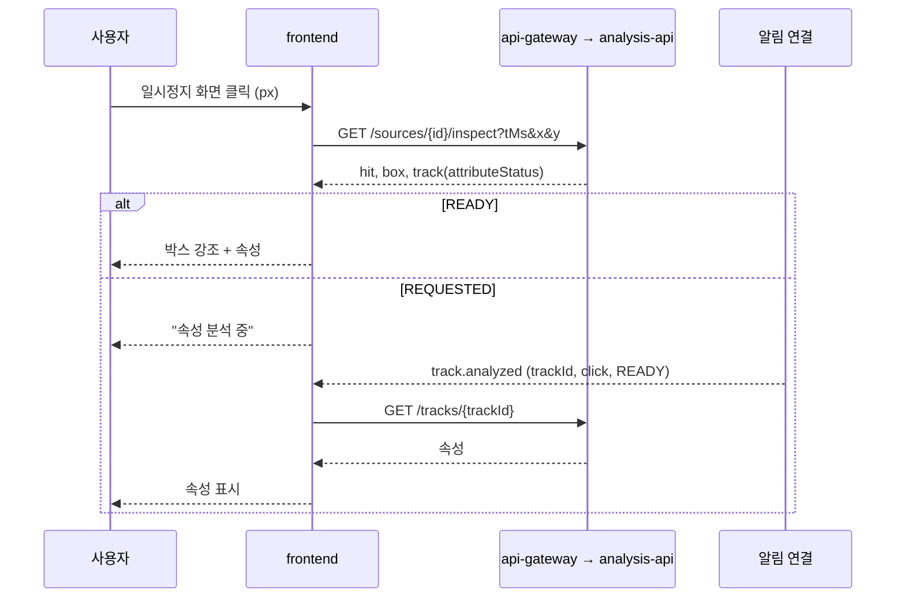

# Plan: SPEC-032 플레이어 오버레이·클릭 조회·객체 질문·위험구역 편집 화면 — frontend

- spec: docs 레포 `docs/specs/SPEC-032-frontend-inspect-zones/spec.md`
- 계약: docs 레포 `service-contracts/` 묶음 3.14.0
  - `openapi/analysis-service.yaml` 0.4.0: `getSourceOverlay`, `inspectPoint`, `getTrack`, `askTrack`, `getTrackQuestion`, `getSourceZones`, `putSourceZones`
  - `notifications/v1/notification-message.schema.json`: `track.analyzed`
  - `events/_track-attribute.schema.json`, `events/_object-answer.schema.json`: 응답 안의 `attributes`·`answer` 형식
- 관련: SPEC-031(영상 상세 조립, 플레이어 컨트롤러·자체 컨트롤, 알림 연결과 버퍼), SPEC-022·SPEC-024(트랙·속성)
- 선행: SPEC-031 T001(계약 lock 4.0.0과 생성 코드), T002·T014(플레이어 이동과 자체 컨트롤), T004·T005(알림 연결)

- v5.1(계약 묶음 4.0.0, 2026-11-07): `openapi/stream-service.yaml` 1.0.0의 카메라 구역 API(`getCameraZones`, `putCameraZones`)가 더해졌다. R-15(보호구 상태는 `ppe_missing` 확정 이벤트 우선)·R-16(카메라 구역 편집)을 아래 설계 절대로 더한다. 생성 코드는 SPEC-031 T028이 만든다.

## 1. 요약

SPEC-031의 영상 상세 플레이어 위에 SVG 층 두 개를 더한다. 하나는 오버레이·클릭 조회 층이고, 다른 하나는 구역 편집 층이다. 두 층은 영상의 실제 표시 영역(레터박스 제외)에 맞춘다. 오버레이는 재생 시각을 포함한 10초 구간을 미리 받아 가장 가까운 탐지 시각의 박스를 그린다. 클릭 조회와 객체 질문은 HTTP 응답 뒤 SSE `track.analyzed`로 속성과 답을 채운다. 구역 편집은 정지 프레임 위에서 SVG 다각형을 직접 다루고, 저장 전에 꼭짓점 수·자기 교차·이름 규칙을 화면에서 먼저 검사한다. 그래픽·편집 라이브러리는 쓰지 않는 것을 기본안으로 둔다(사용자 확인 필요, 5절).

## 2. 담당 요구사항

경로 약어: `A` = `src/features/analysis`, `P` = `src/features/player`, `N` = `src/features/notifications`, `S` = `src/features/stream`

| 요구사항 | 담당 모듈 / 컴포넌트 | 검증 테스트 |
| --- | --- | --- |
| R-1 | `P/components/OverlayLayer`, `P/model/overlayFrame`, `A/api/useSourceOverlay` | `overlayFrame.test.ts`, `OverlayLayer.test.tsx` |
| R-2 | `OverlayLayer`, `P/components/OverlayToggle` | `OverlayLayer.test.tsx` |
| R-3 | `P/components/InspectLayer`, `P/model/contentRect` | `InspectLayer.test.tsx` |
| R-4 | `A/components/TrackPanel`, `A/api/useInspectPoint` | `TrackPanel.test.tsx` |
| R-5 | `A/hooks/useTrackLiveRefresh`, `A/api/useTrack` | `TrackPanel.test.tsx` |
| R-6 | `TrackPanel`, `A/components/InspectResults` | `InspectResults.test.tsx` |
| R-7 | `A/components/TrackQuestions`, `A/api/useAskTrack` | `TrackQuestions.test.tsx` |
| R-8 | `TrackQuestions`, `A/api/useTrackQuestion` | `TrackQuestions.test.tsx` |
| R-9 | `TrackQuestions`, `src/shared/lib/messages.ts` | `TrackQuestions.test.tsx` |
| R-10 | `A/components/ZoneEditor`, `A/api/useSourceZones` | `ZoneEditor.test.tsx` |
| R-11 | `A/model/zoneRules`, `ZoneEditor`, `A/components/ZoneForm` | `zoneRules.test.ts`, `ZoneEditor.test.tsx` |
| R-12 | `A/api/usePutSourceZones`, `ZoneEditor` | `ZoneEditor.test.tsx` |
| R-13 | `A/components/SummaryPanel`(SPEC-031) | `SummaryPanel.test.tsx` |
| R-14 | `P/model/contentRect`, `P/hooks/useVideoContentRect` | `contentRect.test.ts`, `useVideoContentRect.test.tsx` |
| R-15 | `A/model/ppeStatus.ts`(확정 `ppe_missing` 이벤트 → 보호구 상태), `A/components/TrackPanel`(`track_attribute` 값은 보조 표시) | `ppeStatus.test.ts`, `TrackPanel.test.tsx` |
| R-16 | `A/components/ZoneEditor`(저장 함수·배경 프레임을 props로), `S/components/CameraZoneEditor`, `S/api/useCameraZones`·`usePutCameraZones` | `CameraZoneEditor.test.tsx`(저장 뒤 "다음 세션부터 적용됨"), `ZoneEditor.test.tsx`(props 분리 뒤 기존 테스트 유지) |
| NFR-1 | `OverlayLayer`(그리기 시간 측정 표시) | Playwright `inspect-zones.spec.ts`(박스 50개, `performance.measure`) |
| NFR-2 | `InspectLayer`, `TrackPanel` | Playwright `inspect-zones.spec.ts`(응답 뒤 100ms) |

## 3. 원칙 점검

| 원칙 | 준수 | 비고 |
| --- | --- | --- |
| I 스펙 우선 — spec이 Approved 상태인가 | ☑ | docs #127 |
| II 계약 우선 — 계약 변경이 먼저 머지됐는가 | ☑ | analysis 0.4.0은 docs #127로 머지됨. SPEC-031 T001이 4.0.0 생성 코드를 만든다 |
| III 테스트 우선 — 모든 R-*에 테스트가 매핑되고, 태스크가 요구사항 단위 TDD 사이클로 나뉘었는가 | ☑ | 2절, tasks.md |
| IV 서비스 자율성 — 다른 서비스 DB나 코드에 직접 의존하지 않는가 | ☑ | api-gateway 경유 API와 SSE만 쓴다 |
| V 단순성 — 새 의존성이나 추상화가 정당한가 | ☑ | 새 의존성 없음. 박스·다각형은 SVG, 교차 검사는 선분 교차 함수(꼭짓점 32개 이하라 O(n²)로 충분). 선택지는 5절(사용자 확인 필요) |
| VI 관측 가능성 — 로그, 추적, health를 갖췄는가 | ☑ | `console`을 쓰지 않는다. 오버레이 그리기 시간은 `performance.measure`로 남겨 E2E가 읽는다 |
| VII 보안 — 입력 검증, 인가, 비밀값 처리를 했는가 | ☑ | 질문 1~200자, 구역 이름 1~100자를 Zod로 검사한다. 좌표는 0~1로 자른다. 구역 저장 권한은 서버가 판단하고(403), 화면은 안내만 한다 |
| VIII 문서·주석 — spec·계약·plan과 구현이 일치하고, 주석이 왜를 설명하는가 | ☑ | |
| IX GitOps — AWS 변경은 infra, 클러스터 변경은 gitops 레포를 거치는가 | ☑ | 해당 없음 |

## 4. 기술 설계

### 변경 대상

| 경로 | 변경 |
| --- | --- |
| `P/model/contentRect.ts` | `object-fit: contain`인 `<video>`의 표시 영역 계산(요소 크기, `videoWidth`·`videoHeight`) → `{ left, top, width, height }`. 화면 좌표 ↔ 정규화 좌표 변환 |
| `P/hooks/useVideoContentRect.ts` | `ResizeObserver`와 `loadedmetadata`로 다시 계산(R-14) |
| `P/model/overlayFrame.ts` | 10초 구간 경계 계산, 트랙마다 재생 시각에 가장 가까운 `ptsMs` 박스 고르기(이진 탐색) |
| `P/components/OverlayLayer.tsx`, `OverlayToggle.tsx`, `InspectLayer.tsx` | 오버레이 SVG, 켜고 끄기, 클릭 조회 층 |
| `P/components/VideoPlayer.tsx` | 플레이어 묶음 요소 안에 층을 겹칠 자리(`layers`)를 받는다. 전체 화면에서도 층이 함께 보인다 |
| `A/model/schemas.ts` | `Overlay`, `InspectResult`, `TrackAttributes`, `AskAccepted`, `QuestionResult`, `ZoneList` Zod. `attributes`·`answer`는 events JSON Schema를 옮긴 2차 스키마로 해석 |
| `A/model/zoneRules.ts` | 꼭짓점 3~32개, 자기 교차 없음, 이름 1~100자·중복 없음, 구역 20개 이하. 위반 이유 목록을 돌려준다 |
| `A/model/queryKeys.ts` | `overlay(sourceId, windowStart)`, `track(trackId)`, `question(trackId, requestId)`, `zones(sourceId)` |
| `A/api/` | `useSourceOverlay`, `useInspectPoint`(mutation), `useTrack`, `useAskTrack`, `useTrackQuestion`, `useSourceZones`, `usePutSourceZones` |
| `A/components/` | `TrackPanel`, `InspectResults`, `TrackQuestions`, `ZoneEditor`, `ZoneForm`. `SummaryPanel`에 재분석 필요 안내(R-13) |
| `A/hooks/useTrackLiveRefresh.ts` | `track.analyzed` 구독(버퍼 재생 포함) |
| `src/shared/lib/messages.ts` | `ANALYSIS_QUESTION_RATE_LIMITED`, `ANALYSIS_ZONE_INVALID`, 속성 값(안전모·조끼 상태, 역할) 한국어 이름 |
| `src/pages/VideoDetailPage.tsx` | 오버레이·조회 층, 트랙 패널, 구역 편집 열기 버튼 조립 |
| `mocks/analysis.ts`, `tests/e2e/fakeAnalysis.ts` | 위 7개 API 픽스처와 핸들러, `track.analyzed` 알림 |

### 데이터 모델

해당 없음(frontend). 질문 이력과 편집 중인 구역은 화면 컴포넌트 상태에만 둔다.

### API / 이벤트

- analysis-service 0.4.0: `getSourceOverlay`, `inspectPoint`, `getTrack`, `askTrack`, `getTrackQuestion`, `getSourceZones`, `putSourceZones`
- SSE `track.analyzed`(`requestId`, `trackId`, `reason`, `outcome`): SPEC-031 `useNotification`으로 구독한다.

### 표시 영역 맞추기 (R-14)

- `<video>`는 `object-fit: contain`(기본)으로 그려져 영상 비율과 요소 비율이 다르면 위아래나 좌우에 빈 띠가 생긴다. 층은 요소 전체가 아니라 계산한 표시 영역에 `position: absolute`로 놓는다(런타임 계산 값이라 `style` 속성 허용 예외).
- 계산: `scale = min(elW / vw, elH / vh)`, `width = vw × scale`, `left = (elW − width) / 2`(높이도 같게). 메타데이터 전이면 층을 그리지 않는다.
- 정규화 좌표(0~1, 왼쪽 위 기준)는 계약 `NormBox`·`polygon`과 같다. 클릭 좌표는 표시 영역 밖이면 조회하지 않는다.

### 오버레이 (R-1, R-2, NFR-1)

- 켜고 끄기 버튼(`aria-pressed`)은 기본 꺼짐이고 영상마다 기억하지 않는다(컴포넌트 상태).
- 켜져 있으면 재생 시각이 든 10초 창(`[floor(t/10s)×10s, +10s)`)과 다음 창을 미리 받는다(`getSourceOverlay`). 같은 창은 query 캐시로 다시 요청하지 않는다(`staleTime: Infinity`, 화면을 떠나면 버림).
- 그리기: `requestVideoFrameCallback`(없으면 `requestAnimationFrame`)마다 현재 시각을 읽어 트랙마다 가장 가까운 `ptsMs` 박스를 고른다. 박스가 현재 시각에서 탐지 간격(기본 2fps → 500ms)보다 멀면 그리지 않는다(트랙이 사라진 뒤 박스가 남지 않게).
- SVG `<rect>`와 클래스 이름 `<text>`. `hasEvent`면 다른 색·두꺼운 선(R-2). 박스 50개는 React 다시 그리기로도 16ms 안에 들어간다고 보고, 그리기 구간을 `performance.mark/measure("overlay-draw")`로 남겨 E2E에서 확인한다(NFR-1). 넘으면 같은 SVG 요소의 속성만 바꾸는 방식으로 줄인다.
- 오버레이 층은 `pointer-events: none`이라 클릭은 아래 조회 층이 받는다.

### 클릭 조회 (R-3~R-6, NFR-2)

- 조회 층(`InspectLayer`)은 일시정지일 때만 클릭을 받는다. 재생 중이면 층이 `pointer-events: none`이라 자체 컨트롤과 영상이 그대로 동작한다. 누른 점을 표시 영역 기준 0~1 좌표로 바꾸고 `tMs = round(currentTime × 1000)`으로 `inspectPoint`를 부른다(R-3).
- 키보드: 조회 층은 마우스·터치 전용이다. 키보드 사용자를 위해 일시정지 상태에서 오버레이가 켜져 있으면 현재 프레임의 박스를 "트랙 목록" 버튼으로도 보이고, 누르면 그 박스 중심 좌표로 같은 조회를 한다.
- 결과(R-4)
  - 받은 `box`를 강조 박스로 그리고, 트랙 패널에 클래스·등장 구간(`startMs`~`endMs`, 누르면 시작으로 이동)을 보인다.
  - `READY`: 안전모·조끼(착용·미착용·알 수 없음), 역할, 장비, 설명, 판정 상태(SPEC-031 `verification` 이름).
  - `REQUESTED`: "속성 분석 중". `NONE`도 같게 본다(서버가 요청을 냈다고 계약에 적혀 있다).
  - `FAILED`: "속성을 분석하지 못했습니다."
- `hit: false`(R-6): 트랙 패널을 닫고 "이 위치에서 찾은 객체가 없습니다."를 `role="status"`로 알린다.
- 갱신(R-5): 패널이 열린 동안 `track.analyzed`를 구독하고, `trackId`가 같고 `reason`이 `click`·`event`면 `getTrack`을 다시 부른다. 알림이 HTTP 응답보다 먼저 올 수 있어 구독을 시작할 때 SPEC-031 버퍼를 재생한다.

### 객체 질문 (R-7~R-9)

- 트랙 패널 아래 질문 입력(1~200자, React Hook Form + Zod). 보내면 `askTrack({ question, tMs })`.
  - 202: `{ requestId, 질문, 상태 "답을 기다리는 중" }`을 이력 맨 위에 넣는다(R-7). 이력은 트랙 패널을 연 동안만 유지한다.
  - 429 `ANALYSIS_QUESTION_RATE_LIMITED`: 이력에 넣지 않고 "질문이 많습니다. 잠시 뒤 다시 해 주세요."(R-9).
- `track.analyzed`(`reason: question`)의 `requestId`가 이력에 있으면 `getTrackQuestion`을 부른다(R-8).
  - `READY`: 답과 판정 상태. `answerable`이 false면 "화면만으로는 답할 수 없습니다."
  - `FAILED` 또는 `outcome: FAILED`: "답을 만들지 못했습니다."

### 구역 편집 (R-10~R-13)

- "위험구역 편집"을 누르면 `controller.pause()`하고 같은 `<video>`의 현재 프레임 위에 편집 층을 연다. 프레임을 따로 캡처하지 않는다(교차 출처 영상이라 캔버스로 읽을 수 없고, 멈춘 화면으로 충분하다). 편집 중에는 오버레이·조회 층을 숨긴다.
- `getSourceZones`의 구역을 종류별 색(위험구역 빨강, 통로 파랑, 일반 회색 + 이름 글자)으로 그린다(R-10).
- 편집(R-11)
  - 구역 고르기·새 구역 만들기 목록, 이름 입력, 종류 `<select>`.
  - 고른 구역에서 빈 곳 클릭: 꼭짓점 추가(마지막 꼭짓점 뒤). 꼭짓점 끌기(pointer events + `setPointerCapture`): 옮기기. 꼭짓점을 고르고 Delete·"꼭짓점 지우기": 지우기. "구역 지우기".
  - 키보드: 꼭짓점은 `<circle tabIndex={0} aria-label="꼭짓점 n">`이고 화살표로 1%씩, Shift+화살표로 0.1%씩 옮긴다.
  - `zoneRules`가 위반 이유를 돌려주면 저장 버튼을 막고 이유를 버튼 옆에 나열한다. 자기 교차는 이웃하지 않은 변끼리 선분 교차(방향 판정)로 본다.
- 저장(R-12): `putSourceZones({ items })`로 목록 전체를 보낸다(새 구역 `zoneId: null`). 성공하면 응답으로 구역 캐시를 바꾸고 "다음 분석부터 반영됩니다(재분석 필요)."를 보인다. 400 `ANALYSIS_ZONE_INVALID`면 서버 `detail`을, 403이면 "이 영상의 구역을 바꿀 권한이 없습니다."를 보인다.
- R-13: SPEC-031 요약 패널이 `useSourceZones`를 함께 읽어 `reanalysisNeeded`면 "구역이 바뀌어 재분석이 필요합니다." 안내를 보인다.

## 5. 대안과 선택 이유

| 대안 | 장점 | 단점 | 선택 |
| --- | --- | --- | --- |
| 오버레이를 SVG(`<rect>`) | 새 의존성 없음, Testing Library로 보이는 결과 검증, 확대·전체 화면에서 선명 | 박스 수백 개면 DOM 비용 | ☑ |
| 오버레이를 `<canvas>` 2D | 박스가 많아도 빠름 | jsdom에 canvas가 없어 화면 테스트가 어려움, 접근성 정보 없음 | |
| 다각형 편집을 SVG + pointer events 직접 구현 | 새 의존성 없음, 규칙(3~32개·교차·이름)을 우리 코드로 | 끌기·키보드 조작을 직접 구현 | ☑ 기본안(사용자 확인 필요) |
| 편집 라이브러리(Konva·react-konva, Fabric.js 등) | 끌기·선택 내장 | 큰 새 의존성, canvas 기반이라 테스트·접근성 문제 | |
| 자기 교차 검사를 직접(선분 교차) | 꼭짓점 32개 이하라 O(n²) 496쌍, 수십 줄 | 경계 사례(공선, 맞닿음)를 테스트로 확인해야 함 | ☑ |
| 기하 라이브러리(turf 등) | 검증된 구현 | 이 검사 하나에 큰 의존성 | |
| 조회 층을 일시정지일 때만 켬 | 재생 중 클릭은 컨트롤 그대로, spec R-3("일시정지한 영상 위") 그대로 | 재생 중 클릭으로 바로 조회 불가 | ☑ |

## 6. 테스트 전략

- 단위: `contentRect`(가로·세로 레터박스, 같은 비율, 좌표 왕복 변환), `overlayFrame`(창 경계, 가장 가까운 박스, 500ms 넘으면 없음), `zoneRules`(꼭짓점 2·3·32·33개, 사각형·나비 모양 교차, 맞닿은 꼭짓점, 이름 빈칸·101자·중복, 구역 21개), 2차 스키마(`attributes`·`answer` 계약 예시 파싱).
- 컴포넌트: Testing Library + MSW, `[SPEC-032 R-n] ...`.
  - jsdom은 레이아웃이 없어 `<video>`의 `clientWidth`·`videoWidth`를 테스트에서 정의해 두고 클릭 좌표(`clientX`·`clientY`)로 요청 쿼리를 확인한다.
  - SSE는 SPEC-031 `mocks/notifications.ts` 도우미로 `track.analyzed`를 밀어 넣는다. 알림이 HTTP 응답보다 먼저 오는 경우도 한 번 검증한다.
  - 끌기는 `pointerdown`·`pointermove`·`pointerup`(`fireEvent`), 키보드 이동은 `user.keyboard`.
- E2E(Playwright): 클릭 조회 → 속성 분석 중 → 알림 → 속성 표시, 질문 → 답, 구역 그리기 → 저장 → 재분석 안내(spec 성공 지표). NFR-1은 박스 50개 픽스처로 재생하며 `performance.getEntriesByName("overlay-draw")`의 최대값, NFR-2는 응답 fulfill부터 패널 표시까지 시간.

## 7. 리스크와 롤백

- 리스크
  - 오버레이 박스와 구역 좌표는 분석에 쓴 정규화 사본 기준이고, 플레이어는 원본을 재생한다(SPEC-006). 정규화가 회전 보정, 잘라내기, 비율 변경을 하면 박스가 어긋난다. 같은 비율이라고 보고 구현하며, 어긋나면 보고한다.
  - `requestVideoFrameCallback`이 없는 브라우저는 `requestAnimationFrame`으로 대신해 화면 갱신마다 그린다(박스가 영상보다 조금 앞서거나 늦을 수 있음).
  - 계약이 생산자 확인 전 초안이다. 질문 상한·탐지 간격 같은 값은 서버 설정이라 화면에 박지 않는다(500ms 기준만 탐지 간격 기본값을 따른다).
- 롤백 방법: 층과 패널 조립을 되돌리면 된다. 백엔드 변경 없음.

## 8. 배포 고려사항

- 새 환경변수 없음.
- analysis-api 공개 API 2부가 배포되기 전에는 오버레이·조회·구역 편집이 오류 안내를 보인다. SPEC-031과 같이 서비스 배포 뒤에 켜는 것이 좋다.

## 9. v5.1 추가 설계(계약 묶음 4.0.0, 2026-11-07)

- R-15: 트랙 패널은 그 트랙의 이벤트(`listSourceEvents`를 `trackId`로 읽음) 중 `confirmed`인 `ppe_missing`이 있으면 그 이벤트의 `analysis`(누락 보호구)를 보호구 상태로 먼저 표시하고, `track_attribute`의 `ppeState`는 "속성 분석" 보조 줄로 내린다. 확정 이벤트가 없으면 지금처럼 속성 값만 표시한다. 우선순위 계산은 순수 함수 `ppeStatus`다.
- R-16: `ZoneEditor`를 저장 함수(`onSave(zones)`)와 배경 프레임 주소를 props로 받게 나눈다. 업로드 영상은 지금처럼 `putSourceZones`, 카메라는 `putCameraZones`(`PUT /api/v1/stream/cameras/{cameraId}/zones`)를 넘긴다. 카메라 배경은 카메라 상세의 최근 프레임 주소(SPEC-036)이고 없으면 빈 배경에 그린다. 저장 성공 뒤 "다음 세션부터 적용됨"을 표시한다(활성 세션은 stream-service가 `reload_profile`로 받는다). 꼭짓점·이름 규칙(R-11)은 같은 `zoneRules`를 쓴다.

## 10. 구현 반영(2026-11-07)

구현하면서 4절·9절과 달라진 점이다. 요구사항과 계약은 바뀌지 않았다.

- 상태 배치: 층(플레이어 `overlay`)과 패널(플레이어 아래)이 같은 조회·편집 상태를 읽어야 해서 `A/components/VideoInspectProvider`(상태)·`VideoInspectLayers`(층)·`VideoInspectPanel`(도구 막대와 패널)로 나눴다. 페이지는 셋을 조립만 한다. 영상을 바꾸면 `key`로 새로 만들어 오버레이가 다시 꺼진다(R-2).
- 플레이어 층: `VideoPlayer`가 표시 영역을 계산해(`useVideoContentRect`) 그 위에 `overlay`를 놓고, 층은 `usePlayerLayer()`로 화면 좌표를 0~1 좌표로 바꾼다. 층은 기본으로 클릭을 받지 않는다.
- 파일 이름: 다른 작업자와 충돌을 줄이려고 SPEC-032 스키마는 `A/model/inspectSchemas.ts`, API 함수는 `A/api/inspectApi.ts`, 픽스처는 `mocks/inspect.ts`에 따로 뒀다. 카메라 구역은 `S/model/cameraZones.ts`, `S/api/cameraZonesApi.ts`, `mocks/cameraZones.ts`다.
- 오버레이 그리기: 층은 플레이어 조작 창구만 받으므로 `requestVideoFrameCallback` 대신 `requestAnimationFrame`으로 재생 위치를 읽는다(`P/hooks/useFrameTime`). 그리기 시간은 화면 갱신 시작부터 DOM 반영까지를 `overlay-draw`로 남긴다. 이벤트 트랙은 색·굵기와 함께 "· 이벤트" 글자로도 구분한다.
- 구역 편집: 편집 상태는 순수 함수(`A/model/zoneDraft.ts`)로 바꾸고, 그리기 층 `ZoneCanvas`와 패널 `ZoneEditorPanel`(plan의 `ZoneForm`)을 나눴다. 업로드 영상은 둘을 플레이어 위·아래에 따로 놓고, 플레이어가 없는 카메라는 배경 프레임·저장 함수를 props로 받는 `ZoneEditor`를 쓴다(R-16).
  - 꼭짓점은 `<circle>` 대신 위치를 지정한 `<button aria-label="꼭짓점 n">`이다. SVG를 비율대로 늘려도 원이 찌그러지지 않고, 키보드 초점과 이름을 그대로 쓴다.
  - 구역 이름·종류는 입력할 때마다 모든 구역에 걸친 규칙(이름 중복 등)을 다시 보므로 React Hook Form 대신 편집 상태에 바로 둔다. 검사는 `zoneRules`가 한다.
  - 키보드 "꼭짓점 추가"는 오른쪽·아래·왼쪽·위로 돌아 네 번이면 저장할 수 있는 사각형이 된다.
  - 400 `ANALYSIS_ZONE_INVALID`의 서버 이유를 보이려고 `shared/api/problem.ts`의 `ApiError`에 `detail`을 더했다.
- R-15: 계약 `listSourceEvents`에 trackId 거르기가 없어 `eventType=ppe_missing&verificationStatus=confirmed`로 서버에서 줄이고 트랙은 화면에서 고른다(`A/model/ppeStatus.ts`).
- R-16 계약 차이: 카메라 구역은 꼭짓점이 `[x, y]` 배열이고 종류에 `storage`(적치구역)가 더 있으며, 새 구역 ID는 클라이언트가 UUID로 만든다(`replaceCameraZones`). 저장 조건은 업로드 영상과 같은 `zoneRules`(꼭짓점 32개·구역 20개)를 써서 계약 상한(64개·100개)보다 좁다. 카메라 최근 프레임 주소는 계약 Camera에 아직 없어 `frameUrl` props로 받고, 없으면 빈 배경에 그린다. 카메라 화면에 붙이는 일은 카메라 화면 spec(SPEC-034)이 한다.
- 키보드 대안(T018): 일시정지에 오버레이가 켜져 있으면 지금 프레임의 박스를 "트랙 목록" 버튼으로 보인다(`A/components/FrameTrackList`).
