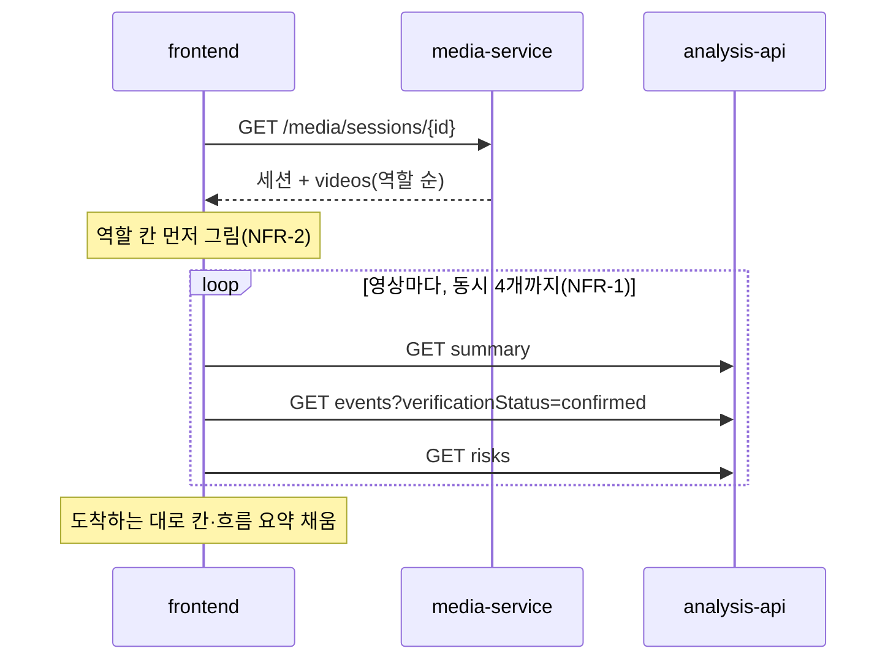

# Plan: SPEC-034 작업 세션·분석 이력 화면과 학습용 보존 설정 화면 — frontend

- spec: docs 레포 `docs/specs/SPEC-034-frontend-sessions-settings/spec.md`
- 계약: docs 레포 `service-contracts/` 묶음 3.14.0(계약 변경 없음)
  - `openapi/media-service.yaml`: `createWorkSession`, `listWorkSessions`, `getWorkSession`, `createVideo`(`sessionId`·`role`), `updateVideoRetentionConsent`, `getRetentionSettings`, `updateRetentionSettings`, `listRetainedVideos`, `revokeRetainedVideo`, `revokeAllRetainedVideos`
  - `openapi/analysis-service.yaml` 0.4.0: `getSourceSummary`, `listSourceEvents`, `listSourceRisks`(SPEC-031)
- 관련: SPEC-005(업로드 대기열), SPEC-006(영상 상세), SPEC-017(작업 세션), SPEC-018(학습용 보존), SPEC-031(분석 요약 API·영상 상세 이동)
- 선행: SPEC-031 T001(계약 lock 3.14.0과 생성 코드), T003(analysis 스키마·API), T013(`videoDetailPath`의 `?event=`·`?t=`), T022(auth `useMe` 내보내기)

## 1. 요약

새 feature 두 개를 만든다. `sessions`는 "분석 이력"(`/history`) 세션 목록·만들기·상세·흐름 요약을, `settings`는 "설정"(`/settings`) 보존 기본값과 보존 중인 삭제 영상을 맡는다. 세션 상세는 media 응답을 먼저 그리고, 영상별 분석 요약·이벤트·위험은 동시 4개까지만 요청해 도착하는 대로 채운다. 업로드 화면의 세션·역할 고르기는 `sessions`가 고르기 컴포넌트를 주고 페이지가 `upload`의 업로드 버튼에 "업로드 대상"으로 넘긴다. 그래서 `upload`가 `sessions`를 import하지 않는다(feature 간 순환 없음). 영상별 보존 동의는 `upload`의 영상 상세에 둔다. 새 의존성은 없다.

## 2. 담당 요구사항

경로 약어: `Se` = `src/features/sessions`, `St` = `src/features/settings`, `U` = `src/features/upload`

| 요구사항 | 담당 모듈 / 컴포넌트 | 검증 테스트 |
| --- | --- | --- |
| R-1 | `Se/components/SessionList`, `Se/api/useWorkSessions`, `src/pages/HistoryPage` | `SessionList.test.tsx` |
| R-2 | `Se/components/CreateSessionForm`, `Se/api/useCreateWorkSession` | `CreateSessionForm.test.tsx` |
| R-3 | `Se/components/SessionDetail`, `Se/components/SessionVideoCard`, `Se/api/useWorkSession`, `Se/api/useSessionVideoSummaries` | `SessionDetail.test.tsx` |
| R-4 | `Se/components/SessionFlow`, `Se/model/sessionFlow` | `sessionFlow.test.ts`, `SessionFlow.test.tsx` |
| R-5 | `SessionFlow` | `SessionFlow.test.tsx` |
| R-6 | `Se/components/SessionRolePicker`, `U/components/UploadButton`·`UploadDropzone`, `U/model/uploadQueue` | `SessionRolePicker.test.tsx`, `uploadQueue.test.ts`, `src/pages/AnalysisUpload.test.tsx` |
| R-7 | `SessionRolePicker`(`resolveTarget`), `uploadQueue` | `src/pages/AnalysisUpload.test.tsx` |
| R-8 | `SessionDetail`, `src/pages/AnalysisPage` | `src/pages/SessionUploadFlow.test.tsx` |
| R-9 | `St/components/RetentionDefaultToggle`, `St/api/useRetentionSettings` | `RetentionDefaultToggle.test.tsx` |
| R-10 | `St/components/RetainedVideoList`, `St/api/useRetainedVideos`, `St/api/useRevokeRetained` | `RetainedVideoList.test.tsx` |
| R-11 | `U/components/RetentionConsentToggle`, `U/api/useUpdateRetentionConsent`, `U/components/VideoDetail` | `RetentionConsentToggle.test.tsx` |
| R-12 | `SessionDetail`, `SessionList`, `src/shared/lib/messages.ts` | `SessionDetail.test.tsx` |
| NFR-1 | `src/shared/lib/limitConcurrency`, `useSessionVideoSummaries` | `limitConcurrency.test.ts`, `SessionDetail.test.tsx`(동시 요청 수 ≤ 4) |
| NFR-2 | `SessionDetail` | `SessionDetail.test.tsx`(요약 전에 영상 칸 표시), Playwright `sessions.spec.ts`(응답 뒤 300ms) |

## 3. 원칙 점검

| 원칙 | 준수 | 비고 |
| --- | --- | --- |
| I 스펙 우선 — spec이 Approved 상태인가 | ☑ | docs #129 |
| II 계약 우선 — 계약 변경이 먼저 머지됐는가 | ☑ | 계약 변경 없음. media(SPEC-017·018)와 analysis 0.4.0을 SPEC-031 T001의 3.14.0 생성 코드로 쓴다 |
| III 테스트 우선 — 모든 R-*에 테스트가 매핑되고, 태스크가 요구사항 단위 TDD 사이클로 나뉘었는가 | ☑ | 2절, tasks.md |
| IV 서비스 자율성 — 다른 서비스 DB나 코드에 직접 의존하지 않는가 | ☑ | media·analysis 공개 API만 쓴다 |
| V 단순성 — 새 의존성이나 추상화가 정당한가 | ☑ | 새 의존성 없음. 동시 요청 제한은 약 20줄 함수(`limitConcurrency`) |
| VI 관측 가능성 — 로그, 추적, health를 갖췄는가 | ☑ | `console`을 쓰지 않는다 |
| VII 보안 — 입력 검증, 인가, 비밀값 처리를 했는가 | ☑ | 세션 이름 1~100자·현장·구역 100자 이하를 Zod로, URL `sessionId`·쪽 번호를 Zod로 검증. 보존 동의 토글은 소유자에게만 보이고 서버도 소유자만 허용한다 |
| VIII 문서·주석 — spec·계약·plan과 구현이 일치하고, 주석이 왜를 설명하는가 | ☑ | |
| IX GitOps — AWS 변경은 infra, 클러스터 변경은 gitops 레포를 거치는가 | ☑ | 해당 없음 |

## 4. 기술 설계

### 변경 대상

| 경로 | 변경 |
| --- | --- |
| `src/shared/lib/limitConcurrency.ts` | 동시에 n개까지만 실행하는 Promise 대기열(NFR-1) |
| `src/shared/lib/messages.ts` | `MEDIA_SESSION_NOT_FOUND`, `MEDIA_SESSION_FULL`, `MEDIA_RETAINED_VIDEO_NOT_FOUND`, 역할 이름(작업 전·중·후) |
| `Se/model/` | `schemas.ts`(`WorkSession`, `WorkSessionDetail`, `WorkSessionPage`, 세션 폼), `queryKeys.ts`, `sessionFlow.ts`(흐름 요약 항목 만들기·정렬), `roles.ts` |
| `Se/api/` | `sessionsApi.ts`, `useWorkSessions`, `useWorkSession`, `useCreateWorkSession`, `useSessionVideoSummaries` |
| `Se/components/` | `SessionList`, `CreateSessionForm`, `SessionDetail`, `SessionVideoCard`, `SessionFlow`, `SessionRolePicker` |
| `St/` (새 feature) | `model/{schemas,queryKeys}.ts`, `api/{settingsApi,useRetentionSettings,useUpdateRetentionSettings,useRetainedVideos,useRevokeRetained}.ts`, `components/{RetentionDefaultToggle,RetainedVideoList}.tsx`, `index.ts` |
| `U/model/uploadQueue.ts` | `addFiles(files, target?)`: 항목에 `{ sessionId, role }`를 두고 `createVideo` 요청에 싣는다 |
| `U/components/UploadButton.tsx`, `UploadDropzone.tsx` | `resolveTarget?: () => Promise<UploadTarget \| null>`를 받는다. 파일을 고른 뒤 대기열에 넣기 전에 부른다. null이면 넣지 않는다(입력 오류) |
| `U/components/RetentionConsentToggle.tsx`, `U/api/useUpdateRetentionConsent.ts`, `U/components/VideoDetail.tsx` | 영상 상세의 보존 동의 |
| `src/pages/HistoryPage.tsx`, `SessionDetailPage.tsx`, `SettingsPage.tsx`, `AnalysisPage.tsx`, `src/app/routes.tsx` | `/history`, `/history/sessions/:sessionId`, `/settings` 라우트(lazy). ComingSoon 목록에서 뺀다. `AnalysisPage`는 `SessionRolePicker`를 업로드 버튼 옆에 둔다 |
| `mocks/media.ts`(세션·보존 핸들러), `tests/e2e/fakeMedia.ts` | 세션·보존 API 가짜 응답 |

### 데이터 모델

해당 없음(frontend).

### API / 이벤트

- media-service: `listWorkSessions`, `createWorkSession`, `getWorkSession`, `createVideo`(`sessionId`·`role`), `updateVideoRetentionConsent`, `getRetentionSettings`, `updateRetentionSettings`, `listRetainedVideos`, `revokeRetainedVideo`, `revokeAllRetainedVideos`
- analysis-service: `getSourceSummary`, `listSourceEvents`(`verificationStatus=confirmed`), `listSourceRisks`

### 분석 이력 (R-1, R-2, R-12)

- `/history`: `useWorkSessions(page)` → `listWorkSessions`(`size=20`, 최신순). 행: 이름(세션 상세 링크), 현장, 구역, 만든 시각. `?page=`는 SPEC-005 `Pagination`과 같다.
- 세션이 없으면 `EmptyState`에 "작업 세션이 없습니다."와 "세션 만들기".
- "세션 만들기": `CreateSessionForm`(이름 필수 1~100자, 현장·구역 선택 100자 이하). 성공하면 `/history/sessions/{id}`로 이동하고 목록을 무효화한다. 400이면 서버 `code` 문구를 입력 옆에 보인다.
- 오류(R-12): 404 `MEDIA_SESSION_NOT_FOUND`면 "세션을 찾을 수 없습니다."(목록 링크), 5xx·네트워크면 "다시 시도".

### 세션 상세 (R-3~R-5, R-8, NFR-1, NFR-2)

- `useWorkSession(id)`의 `videos`를 역할 칸(작업 전 → 작업 중 → 작업 후)에 받은 순서대로 넣는다. 서버 순서가 이미 역할·완료 시각 순이므로 다시 정렬하지 않는다. 빈 칸은 "영상 없음".
- 영상 카드: 파일 이름(영상 상세 링크), media 상태 이름(SPEC-005), 분석 상태(`summary.status`: 분석 전·분석됨), 확정 이벤트 수(`counts.confirmedEvents`), 끝까지 활성인 위험 수(`counts.activeRisks`). 요약이 오기 전에는 "분석 정보 불러오는 중".
- 동시 제한(NFR-1): 세션 화면이 `limitConcurrency(4)` 대기열 하나를 만들고, 영상별 summary·events·risks query의 `queryFn`을 그 대기열로 감싼다(`useQueries`). 요청 하나하나가 대기열의 한 자리라 어느 순간에도 analysis 요청은 4개 이하다.
- 흐름 요약(R-4, `sessionFlow.ts`)
  - 항목: 영상마다 `listSourceRisks`에서 `carriedOver: true`인 위험("이전 영상에서 이어짐" 표시, 시작 시각 `firstSeenMs`)과, `listSourceEvents(verificationStatus=confirmed)` 결과 중 유형 `barrier_not_restored`(방호 미복구)·`object_removed`(물건 제거)·`object_moved`(물건 이동)인 이벤트(`startMs`).
  - 정렬: 영상의 세션 안 순서(역할 순, 같은 역할은 받은 순서), 그다음 영상 안 시각.
  - 누르면 이벤트는 `videoDetailPath(sourceId, { eventId })`, 위험은 `videoDetailPath(sourceId, { seekMs: firstSeenMs })`.
  - 이벤트가 100개를 넘는 영상은 다음 쪽도 같은 대기열로 받는다.
- 미완료 안내(R-5): 영상 중 media 상태가 `READY`가 아니거나 요약이 `NOT_ANALYZED`인 영상이 있으면 흐름 요약 위에 "분석이 끝나지 않은 영상이 있어 비교가 완전하지 않습니다."를 보인다.
- "이 세션에 영상 올리기"(R-8): `/analysis?sessionId={id}`로 이동한다. 업로드 화면은 이 값을 Zod(uuid)로 읽어 `SessionRolePicker`의 처음 값으로 쓴다.

### 업로드 화면의 세션·역할 (R-6, R-7)

- `SessionRolePicker`(sessions): 세션 `<select>`(없음 · 내 세션(최근 100개) · 새 세션), 새 세션이면 이름 입력, 역할 라디오(작업 전·중·후). 세션을 고르면 역할이 필수다. 입력 오류는 고르기 옆에 보인다.
- 페이지가 `picker`의 `resolveTarget`을 `UploadButton`·`UploadDropzone`에 넘긴다. 파일을 고르면 업로드 컴포넌트가 `resolveTarget()`을 먼저 부른다.
  - 없음: `undefined` → 지금처럼 올린다.
  - 내 세션: `{ sessionId, role }`.
  - 새 세션(R-7): `createWorkSession({ name })`을 먼저 보내고, 만든 ID로 `{ sessionId, role }`. 같은 고르기에서 여러 파일을 고르거나 두 번째로 고를 때는 만든 세션을 재사용하게 고르기 값을 그 세션으로 바꾼다.
  - 역할이 비었거나 세션 만들기가 실패하면 `null` → 대기열에 넣지 않고 이유를 보인다.
- `uploadQueue`: 항목의 `target`을 `createVideo` 본문의 `sessionId`·`role`로 싣는다(R-6). 세션이 가득 차면(`MEDIA_SESSION_FULL`) 그 항목이 SPEC-005 실패 처리로 끝난다.

### 설정 (R-9, R-10)

- `/settings`: `getRetentionSettings` → `RetentionDefaultToggle`(`role="switch"`, `aria-checked`). 바꾸면 `updateRetentionSettings` → 성공하면 "이후에 올리는 영상에 적용됩니다."를 `role="status"`로. 실패하면 이전 값으로 되돌리고 오류 문구.
- 보존 중인 삭제 영상: `listRetainedVideos(page, size=20)` → 영상 ID, 삭제 시각, 보존 만료 시각(`retainUntil`). `Pagination`.
  - 하나 철회: 행의 "철회" → `ConfirmDialog` → `revokeRetainedVideo` → 목록 무효화. 404 `MEDIA_RETAINED_VIDEO_NOT_FOUND`면 안내 후 무효화.
  - 전체 철회: `ConfirmDialog`("보존 중인 영상 n개의 학습용 데이터를 모두 지웁니다") → `revokeAllRetainedVideos` → 무효화.

### 영상별 보존 동의 (R-11)

- `VideoDetail`(upload)에서 `useMe().data.id === video.ownerId`일 때만 `RetentionConsentToggle`을 보인다(ADMIN도 소유자가 아니면 숨긴다. 계약상 소유자만 바꿀 수 있다).
- 바꾸면 `updateVideoRetentionConsent({ consent })` → 상세 캐시를 응답으로 바꾸고 "영상을 지울 때의 값이 적용됩니다."를 보인다.

## 5. 대안과 선택 이유

| 대안 | 장점 | 단점 | 선택 |
| --- | --- | --- | --- |
| 세션 고르기를 `sessions`에 두고 페이지가 업로드 대상을 넘김 | feature 간 순환 없음(`sessions → upload` 한 방향), 업로드 대기열은 세션을 모름 | 페이지 조립이 조금 늘어남 | ☑ |
| `upload`가 `sessions`를 import | 업로드 화면 안에서 끝남 | `sessions`도 `upload`(영상 상세 주소·상태 이름)를 써서 순환 | |
| 흐름 요약 이벤트를 `verificationStatus=confirmed` 한 번 받아 유형을 화면에서 거름 | 영상당 events 요청 1번 | 확정 이벤트가 많은 영상은 쪽이 늘어남 | ☑ |
| 유형 세 개를 따로 요청 | 받는 데이터가 적음 | 계약 `eventType`이 값 하나라 영상당 3번, 20개 영상이면 60번 | |
| 동시 제한을 직접(`limitConcurrency`) | 새 의존성 없음, 20줄 | 직접 테스트 | ☑ |
| `p-limit` 등 라이브러리 | 검증된 구현 | 이 함수 하나에 의존성 추가 | |

## 6. 테스트 전략

- 단위: `limitConcurrency`(동시 실행 최대 n, 실패해도 다음 실행), `sessionFlow`(역할 순·시각 순 정렬, 유형 거르기, 이어 온 위험 포함), 세션 폼 스키마.
- 컴포넌트·흐름: Testing Library + MSW, `[SPEC-034 R-n] ...`.
  - NFR-1: MSW 핸들러가 응답을 늦추면서 동시에 진행 중인 analysis 요청 수의 최대값을 센다.
  - NFR-2: summary 응답을 늦춰도 역할 칸과 영상 이름이 먼저 보이는지 확인한다.
  - R-7: `createWorkSession`이 첫 `createVideo`보다 먼저 불리고, 그 ID가 `createVideo` 본문에 실리는지(MSW 요청 순서·본문).
- E2E(Playwright): 세션 만들기 → 작업 전·후 영상 올리기 → 세션 상세의 역할별 표시, 흐름 요약 이동(US-1·US-2, P1). 세션 상세 응답 뒤 300ms 안에 역할 칸 표시. analysis는 `fakeAnalysis.ts`.
- 시연: 로컬 compose(media·auth 실제) + `VITE_API_MOCKING=true`(analysis mock, SPEC-031 T026)로 성공 지표 확인.

## 7. 리스크와 롤백

- 리스크
  - "확정 이벤트"를 판정 상태 `confirmed`로 본다(SPEC-031 요약의 `confirmedEvents`와 같은 뜻이라고 가정). 운영자 확인 상태(`reviewState: CONFIRMED`)를 뜻한다면 거르기 값만 바꾼다. 보고에 적는다.
  - 재고 비교 이벤트(`object_removed`·`object_moved`, origin `inventory`)와 규칙 이벤트(`barrier_not_restored`)의 판정 상태가 `confirmed`로 저장되는지 계약에 적혀 있지 않다. 다르면 흐름 요약에서 빠진다.
  - 세션 영상 20개면 analysis 요청이 60번 이상이다(동시 4개). 느리면 세션 요약용 API를 analysis 담당자에게 제안한다.
- 롤백 방법: 라우트를 ComingSoon으로 되돌리고 업로드 고르기를 빼면 된다. 업로드 대기열의 `target`은 선택 값이라 빼도 기존 업로드는 그대로다.

## 8. 배포 고려사항

- 새 환경변수 없음.
- media-service 세션·보존 API는 이미 있다. analysis-api가 배포되기 전에는 세션 상세의 분석 칸이 오류 안내를 보이고 영상 목록·이동은 그대로 쓸 수 있다.
