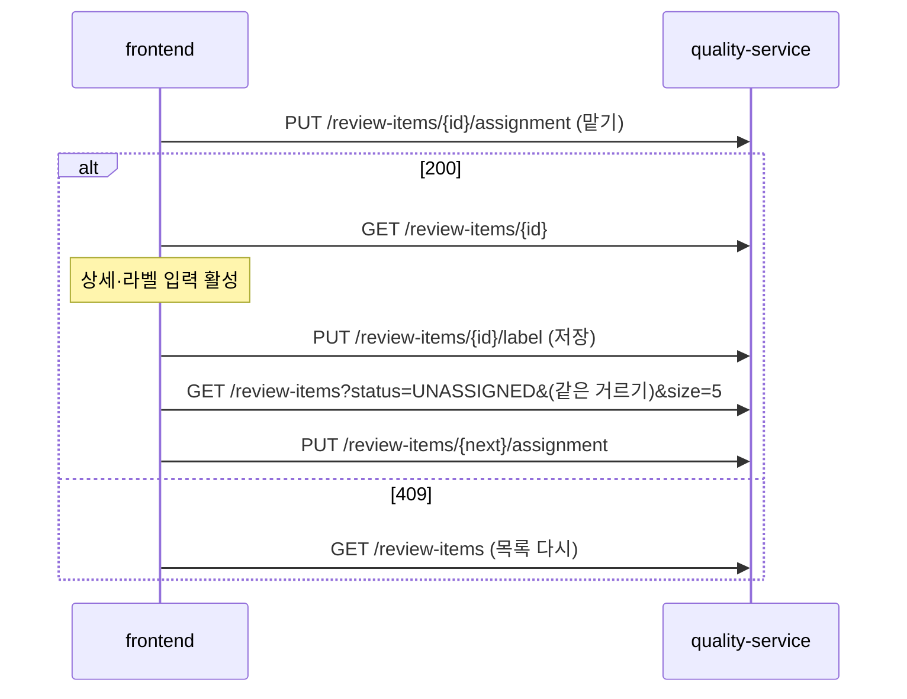

# Plan: SPEC-035 품질 화면(검토 큐·Golden Set·평가 실행·처리 단계·데이터셋 가져오기) — frontend

- spec: docs 레포 `docs/specs/SPEC-035-frontend-quality/spec.md`
- 계약: docs 레포 `service-contracts/` 묶음 3.14.0
  - `openapi/quality-service.yaml` 1.2.0: `listReviewItems`, `getReviewItem`, `assignReviewItem`, `releaseReviewItem`, `labelReviewItem`, `createGoldenSet`, `listGoldenSets`, `getGoldenSet`, `addGoldenSetEntry`, `listGoldenSetEntries`, `deleteGoldenSetEntry`, `createGoldenSetVersion`, `listGoldenSetVersions`, `setGoldenSetBaseline`, `listEvaluationRuns`, `getEvaluationRun`, `getSourceStageReport`, `getStageTrend`, `createDatasetImport`, `listDatasetImports`, `getDatasetImport`, `createFeatureExport`, `getFeatureExport`
  - `events/_vlm-analysis.schema.json`: `ReviewItem.analysis` 형식
- 관련: SPEC-002(메뉴·레이아웃), SPEC-029·SPEC-030(quality-service), SPEC-031(auth `useHasRole`·`useMe`, 판정 상태·severity 이름)
- 이 spec의 backend 몫(`ReviewItem.evidenceFrameUrls` 채우기)은 backend 레포 plan이 맡는다. 이 plan은 frontend 몫(R-1~R-20, NFR-1, NFR-2)만 다룬다.
- 선행: SPEC-031 T001(계약 lock 4.0.0과 생성 코드), T022(auth `useHasRole`·`useMe` 내보내기)

- v5.1(계약 묶음 4.0.0, 2026-11-07): `openapi/quality-service.yaml` 2.0.0은 검토 사유를 열린 목록(`x-extensible-enum`)으로 바꾸고 `budget_exceeded`·`call_cap_reached`·`model_unavailable`·`alert_dismissed`를 더했으며 목록 필터 `reason`과 알림 지표 리포트 `getAlertReport`를 더했다. R-21(사유 필터·안내)·R-22(긴급 알림 지표)를 아래 설계 절대로 더한다. 생성 코드는 SPEC-031 T028이 만든다.

## 1. 요약

새 feature `quality`에 OPERATOR 전용 "품질" 메뉴(`/quality`)와 하위 탭 다섯 개(검토 큐, Golden Set, 평가 실행, 처리 단계, 데이터셋)를 만든다. 품질 라우트 전체는 lazy 묶음 하나로 나눠 USER의 첫 화면 코드에 들어가지 않게 한다(NFR-2). 검토 상세는 맡기 → 라벨 → "저장 후 다음"이 한 화면에서 이어지게 하고, 다음 항목 맡기는 저장 직후 바로 요청한다. 추이 그래프는 SVG로 직접 그리는 것을 기본안으로 둔다(사용자 확인 필요, 5절). 진행 중인 가져오기·내보내기는 TanStack Query `refetchInterval`로 5초마다 다시 읽는다.

## 2. 담당 요구사항

경로 약어: `Q` = `src/features/quality`

| 요구사항 | 담당 모듈 / 컴포넌트 | 검증 테스트 |
| --- | --- | --- |
| R-1 | `src/app/layout/menu.ts`·`Sidebar`·`MobileNav`(역할별 메뉴), `Q/components/RequireOperator`, `src/app/routes.tsx` | `src/app/layout/AppLayout.test.tsx`, `RequireOperator.test.tsx` |
| R-2 | `Q/components/review/ReviewQueue`, `Q/api/useReviewItems` | `ReviewQueue.test.tsx` |
| R-3 | `ReviewQueue`, `Q/api/useAssignReviewItem` | `ReviewQueue.test.tsx` |
| R-4 | `Q/components/review/ReviewDetail`, `Q/components/review/EvidenceFrames`, `Q/api/useReviewItem` | `ReviewDetail.test.tsx` |
| R-5 | `Q/components/review/ReviewLabelForm`, `Q/model/labelSchema` | `labelSchema.test.ts`, `ReviewLabelForm.test.tsx` |
| R-6 | `ReviewDetail`, `Q/api/useLabelAndNext` | `ReviewDetail.test.tsx` |
| R-7 | `ReviewDetail`, `Q/api/useReleaseReviewItem` | `ReviewDetail.test.tsx` |
| R-8 | `Q/components/golden/GoldenSetList`, `Q/components/golden/CreateGoldenSetForm` | `GoldenSetList.test.tsx`, `CreateGoldenSetForm.test.tsx` |
| R-9 | `Q/components/review/AddToGoldenSet` | `AddToGoldenSet.test.tsx` |
| R-10 | `Q/components/golden/GoldenSetDetail` | `GoldenSetDetail.test.tsx` |
| R-11 | `Q/components/runs/EvaluationRunDetail`(기준 지정) | `EvaluationRunDetail.test.tsx` |
| R-12 | `Q/components/runs/EvaluationRunList` | `EvaluationRunList.test.tsx` |
| R-13 | `EvaluationRunDetail`, `Q/model/gate` | `gate.test.ts`, `EvaluationRunDetail.test.tsx` |
| R-14 | `Q/components/stages/SourceStageReport` | `SourceStageReport.test.tsx` |
| R-15 | `Q/components/stages/StageTrend`, `Q/components/stages/TrendChart`, `Q/model/chartScale` | `chartScale.test.ts`, `StageTrend.test.tsx` |
| R-16 | `Q/components/datasets/CreateImportForm` | `CreateImportForm.test.tsx` |
| R-17 | `Q/model/polling`, `Q/api/useDatasetImports`·`useFeatureExport` | `polling.test.ts`, `DatasetImports.test.tsx` |
| R-18 | `Q/components/datasets/DatasetImportDetail` | `DatasetImportDetail.test.tsx` |
| R-19 | `Q/components/datasets/FeatureExportPanel`, `Q/model/exportSchema` | `FeatureExportPanel.test.tsx` |
| R-20 | `Q/components/QualityError`, `src/shared/lib/messages.ts` | `QualityError.test.tsx`, `messages.test.ts` |
| R-21 | `Q/model/reviewReason.ts`(열린 목록·한국어 이름·안내 문구), `Q/components/review/ReviewFilters`(사유 필터), `ReviewDetail`(예산·상한 안내) | `reviewReason.test.ts`, `ReviewFilters.test.tsx`, `ReviewDetail.test.tsx` |
| R-22 | `Q/api/useAlertReport`(`getAlertReport`), `Q/components/stages/AlertReportPanel` | `AlertReportPanel.test.tsx` |
| NFR-1 | `useLabelAndNext`(저장 직후 다음 항목 맡기), `ReviewDetail` | Playwright `quality.spec.ts`(저장 응답 뒤 300ms) |
| NFR-2 | `src/app/routes.tsx`(품질 라우트 lazy 하나) | Playwright `quality.spec.ts`(USER 첫 화면이 품질 묶음을 받지 않음) |

## 3. 원칙 점검

| 원칙 | 준수 | 비고 |
| --- | --- | --- |
| I 스펙 우선 — spec이 Approved 상태인가 | ☑ | docs #130 |
| II 계약 우선 — 계약 변경이 먼저 머지됐는가 | ☑ | quality 1.2.0(`evidenceFrameUrls`)은 docs #130으로 머지됨. SPEC-031 T001이 4.0.0 생성 코드를 만든다 |
| III 테스트 우선 — 모든 R-*에 테스트가 매핑되고, 태스크가 요구사항 단위 TDD 사이클로 나뉘었는가 | ☑ | 2절, tasks.md |
| IV 서비스 자율성 — 다른 서비스 DB나 코드에 직접 의존하지 않는가 | ☑ | quality-service 공개 API만 쓴다 |
| V 단순성 — 새 의존성이나 추상화가 정당한가 | ☑ | 새 의존성 없음. 그래프는 SVG 직접(축·선 두 개·점), 폴링은 `refetchInterval`. 선택지는 5절(사용자 확인 필요) |
| VI 관측 가능성 — 로그, 추적, health를 갖췄는가 | ☑ | `console`을 쓰지 않는다 |
| VII 보안 — 입력 검증, 인가, 비밀값 처리를 했는가 | ☑ | 메뉴·라우트는 OPERATOR만, 서버도 403. 폼(라벨, 세트 이름 패턴, 매니페스트 경로 패턴, 비율 0~1, 기간 90일)은 Zod. 근거 프레임 서명 주소는 메모리에만 둔다 |
| VIII 문서·주석 — spec·계약·plan과 구현이 일치하고, 주석이 왜를 설명하는가 | ☑ | |
| IX GitOps — AWS 변경은 infra, 클러스터 변경은 gitops 레포를 거치는가 | ☑ | 해당 없음 |

## 4. 기술 설계

### 변경 대상

| 경로 | 변경 |
| --- | --- |
| `src/app/layout/menu.ts` | `MenuItem.requiredRole?: "OPERATOR"`, "품질"(`/quality`, 아이콘 `ShieldCheck`) 추가 |
| `src/app/layout/Sidebar.tsx`, `MobileNav.tsx` | `useHasRole`로 `requiredRole`이 맞지 않는 메뉴를 뺀다 |
| `src/app/routes.tsx` | `/quality/*` 하나를 `lazy`로 `pages/QualityPage`를 불러오고, 하위 라우트는 그 묶음 안에 둔다 |
| `src/pages/QualityPage.tsx` | `RequireOperator` + 탭 내비게이션(`NavLink` 다섯 개) + `<Outlet>` |
| `Q/model/` | `schemas.ts`(생성 타입 `satisfies`, `analysis`는 SPEC-031 2차 스키마), `queryKeys.ts`, `labelSchema.ts`, `goldenSetSchema.ts`, `importSchema.ts`, `exportSchema.ts`, `trendQuery.ts`(90일 검사), `gate.ts`(실패 지표 차이·정렬), `chartScale.ts`, `polling.ts`(진행 중 상태 판단) |
| `Q/api/` | `qualityApi.ts`와 훅(`useReviewItems`, `useReviewItem`, `useAssignReviewItem`, `useReleaseReviewItem`, `useLabelAndNext`, `useGoldenSets`, `useGoldenSet`, `useGoldenSetEntries`, `useGoldenSetVersions`, `useCreateGoldenSet`, `useAddGoldenSetEntry`, `useDeleteGoldenSetEntry`, `useFreezeGoldenSet`, `useSetBaseline`, `useEvaluationRuns`, `useEvaluationRun`, `useSourceStageReport`, `useStageTrend`, `useDatasetImports`, `useDatasetImport`, `useCreateDatasetImport`, `useCreateFeatureExport`, `useFeatureExport`) |
| `Q/components/` | `RequireOperator`, `QualityError`, `review/*`, `golden/*`, `runs/*`, `stages/*`, `datasets/*` |
| `src/shared/lib/messages.ts` | `QUALITY_*` 오류 문구, verdict·사유·상태 이름 |
| `mocks/quality.ts`, `tests/e2e/fakeQuality.ts` | 계약 예시 픽스처와 핸들러 |

### 데이터 모델

해당 없음(frontend). 이 화면에서 시작한 특징 내보내기 ID 목록만 메모리(컴포넌트 상태)에 둔다.

### API / 이벤트

1절 계약의 operationId 23개. 알림(SSE)은 쓰지 않는다.

### 라우트

| 경로 | 화면 |
| --- | --- |
| `/quality` | `/quality/review`로 바꿔 보냄 |
| `/quality/review`, `/quality/review/:itemId` | 검토 큐, 검토 상세 |
| `/quality/golden-sets`, `/quality/golden-sets/:setId` | Golden Set 목록, 상세 |
| `/quality/runs`, `/quality/runs/:runId` | 평가 실행 목록, 상세 |
| `/quality/stages` | 처리 단계(단계 분해, 추이) |
| `/quality/datasets`, `/quality/datasets/imports/:importId` | 가져오기·내보내기, 가져오기 상세 |

- 경로 파라미터와 거르기 쿼리는 Zod로 검증한다. 거르기 값(상태·사유·유형·Golden Set·쪽 번호)은 URL 쿼리에 둔다(뒤로 가기, R-6의 "같은 거르기 조건").

### 메뉴와 권한 (R-1, R-20)

- 사이드바·모바일 메뉴는 `useHasRole("OPERATOR")`가 거짓이면 "품질"을 그리지 않는다. 내 정보가 오기 전에도 숨긴다.
- `RequireOperator`: 내 정보를 불러오는 중이면 로딩, OPERATOR가 아니면 "이 화면을 볼 권한이 없습니다."(R-1). 품질 API가 403을 돌려줘도 같은 문구를 보인다(R-20). 5xx·네트워크 오류면 오류 문구와 "다시 시도"(`QualityError`가 공통으로 처리).

### 검토 큐 (R-2~R-7, NFR-1)

- 목록(R-2): `listReviewItems(status, reason, eventType, page, size=20)`, 만든 순서. 행: 유형 이름, 구간, 판정 방식, 사유(`review_required` 검토 필요·`sample` 표본), 상태 이름, 맡은 사람(`assigneeId === me.id`면 "나", 아니면 "다른 운영자", 없으면 "-"). `UNASSIGNED` 행에 "맡기", 내가 맡은 행에 "이어서 보기".
- 맡기(R-3): `assignReviewItem` → 성공하면 `/quality/review/{id}?<같은 거르기>`로 이동. 409 `QUALITY_REVIEW_ALREADY_ASSIGNED`면 "이미 다른 사람이 맡았습니다.", `QUALITY_REVIEW_ALREADY_LABELED`면 "이미 라벨된 항목입니다."를 보이고 목록을 무효화한다.
- 상세(R-4): 근거 프레임(`evidenceFrameUrls`의 ``, alt "근거 프레임 n"), 판정 결과(`analysis` 해석: 설명·위험 사유·severity·판정 상태), 판정 방식, 판정 이유(`reviewReasons`). 이미지 `onError`가 나면 상세를 한 번 다시 불러와 새 서명 주소를 받는다. 다시 받은 뒤에도 실패하면 "근거 프레임을 불러오지 못했습니다."(무한 재요청 방지).
- 라벨(R-5): React Hook Form + `labelSchema`(Zod `superRefine`).
  - `assigneeId === me.id`이고 상태가 `ASSIGNED`일 때만 입력이 활성이다.
  - verdict(맞음·틀림·불확실), 이벤트 유무 스위치, 유형(`taxonomy` 값), 시작·끝 시각(초 입력 → ms), severity, 메모 500자.
  - 이벤트 유무가 켜지면 유형·시작·끝 필수, 끝 > 시작. 꺼지면 유형 값을 비운다(`setValue(null)`). 위반이면 저장 버튼을 막고 이유를 보인다.
- 저장 후 다음(R-6, NFR-1): `useLabelAndNext`가 `labelReviewItem` → 성공하면 같은 거르기의 `UNASSIGNED` 첫 쪽(`size=5`)을 받아 앞에서부터 `assignReviewItem`을 시도한다(409면 다음 후보). 맡으면 그 상세로 `replace` 이동한다. 다음 상세는 맡기 응답으로 캐시를 미리 채워 이동 즉시 그린다. 후보가 없으면 "남은 항목이 없습니다."와 목록 링크.
- 내려놓기(R-7): `releaseReviewItem` → 목록으로 이동, 목록 무효화.

### Golden Set (R-8~R-10)

- 목록(R-8): 이름, 분할(dev·eval), 출처(검토·가져오기), 초안 수, 최신 버전(없으면 "-"), 기준 실행(있으면 실행 상세 링크). "만들기" 폼: 이름(`^[a-z0-9][a-z0-9-]{0,62}$`, 위반 이유 표시), 분할, 설명 500자. 409 `QUALITY_GOLDEN_SET_DUPLICATED`면 이름 옆에 안내.
- 초안에 넣기(R-9): 라벨된(`LABELED`) 검토 상세에 "Golden Set에 넣기" → 출처가 `review`인 세트만 고르기 목록에 보인다 → `addGoldenSetEntry({ reviewItemId })`. 409 코드별 이유: `QUALITY_REVIEW_NOT_LABELED` 라벨 없음, `QUALITY_GOLDEN_ENTRY_DUPLICATED` 이미 들어 있음, `QUALITY_GOLDEN_ORIGIN_MISMATCH` 가져온 데이터셋 세트. 계약은 uncertain 라벨도 `QUALITY_REVIEW_NOT_LABELED`로 돌려주므로, 화면에 있는 라벨의 verdict가 `uncertain`이면 그 코드를 "불확실 라벨은 넣을 수 없습니다"로 보인다.
- 상세(R-10): 초안 항목 목록(`listGoldenSetEntries`, 행마다 "빼기" → `deleteGoldenSetEntry`), 확정 버전 목록(`listGoldenSetVersions`: 버전, 항목 수, 매니페스트 경로 `manifestKey`, 확정 시각, 확정한 사람), "버전 확정" → `ConfirmDialog` → `createGoldenSetVersion`. 성공하면 새 버전·매니페스트 경로를 보이고 세트·초안·버전 query를 무효화한다. 409 `QUALITY_GOLDEN_EMPTY` 초안 없음, `QUALITY_GOLDEN_FREEZE_IN_PROGRESS` 확정 진행 중.

### 평가 실행 (R-11~R-13)

- 목록(R-12): `listEvaluationRuns(goldenSetId?)` 받은 시각 내림차순. 열: Golden Set 이름(목록 query로 이름 찾기), 버전, 종류, 트리거, Gate 결과(`gate.passed` true 통과·false 실패·null 기준 없음, 색과 글자). Golden Set 고르기로 거른다.
- 상세(R-13): 버전 정보(`RunVersions` 항목, `commitSha`), Gate 결과. 실패면 `gate.failures`를 맨 위 강조 표(이름, 유형, 기준값, 실행값, 차이 = 실행값 − 기준값, 부호 표시)로, 그 아래 전체 지표를 이름·유형 순 표로. `baselineRunId`가 null이면 "기준 실행 없음".
- 기준으로 지정(R-11): `setGoldenSetBaseline(goldenSetId, { runId })` → 세트·실행 query 무효화. 409 `QUALITY_RUN_SET_MISMATCH`면 "다른 Golden Set의 실행입니다."

### 처리 단계 (R-14, R-15)

- 단계 분해(R-14): 영상 ID 입력(uuid) → `getSourceStageReport`. 표: 단계 경로, 개수, 합계, p50, p95, 오류 수. 합계 내림차순으로 화면에서 정렬한다. 404 `QUALITY_SOURCE_NOT_FOUND`면 "측정 기록 없음(90일 보존)".
- 추이(R-15): 단계 ID, 기간(`from`·`to` 날짜), 버전 키(선택: 계약 `versionKey` enum 값)와 값. `trendQuery`가 `to − from ≤ 90일`을 검사하고 넘으면 요청하지 않고 이유를 보인다. 결과는 `TrendChart`(SVG 선 그래프: x 날짜, y ms, p50·p95 두 선, 선마다 색 + 범례 글자, 점에 `<title>` 값)와 같은 데이터의 표. 그래프는 `role="img"`와 요약 `aria-label`을 달고, 정확한 값은 표로 읽게 한다.
- `chartScale`: 값 범위 → 눈금(1·2·5 단위), 날짜 → x 위치. 날짜가 하루뿐이면 점 하나.

### 데이터셋 (R-16~R-19)

- 가져오기 시작(R-16): 매니페스트 경로(`^imports/[A-Za-z0-9._-]{1,100}/manifest[.]json$`), 평가 비율(0~1, 기본 0.2), 분할 시드(0 이상 정수, 기본 0) → `createDatasetImport`. 성공하면 목록 무효화. 409 `QUALITY_IMPORT_IN_PROGRESS`면 "같은 매니페스트를 가져오는 중입니다."
- 목록·폴링(R-17): `listDatasetImports`. `refetchInterval`이 `polling.isImportActive`(`PENDING`·`VALIDATING`·`REGISTERING`)인 항목이 있을 때만 5000ms를 돌려준다. 목록 전체를 다시 읽는 것으로 "그 항목의 상태"를 갱신한다(목록 한 번이 항목별 요청보다 적다). 상세 화면도 같은 조건으로 `getDatasetImport`를 다시 읽는다.
- 가져오기 상세(R-18): 상태, 영상·등록·실패·라벨·dev·eval 개수, 만든 Golden Set 버전(`goldenSets`의 세트 상세 링크), 오류 목록.
- 특징 내보내기(R-19): Golden Set 고르기와 기간(최대 90일) 중 하나만. 한쪽을 채우면 다른 쪽 입력을 막는다(`exportSchema`가 둘 다·둘 다 없음을 거절). `createFeatureExport` → 받은 ID를 이 화면의 내보내기 목록(메모리)에 넣고 `getFeatureExport`를 `PENDING`·`RUNNING`인 동안 5초마다 읽는다. 완료되면 파일 경로·줄 수·영상 수를 보인다. 계약에 내보내기 목록 API가 없어 화면을 떠나면 목록이 사라진다(보고에 적음).

## 5. 대안과 선택 이유

| 대안 | 장점 | 단점 | 선택 |
| --- | --- | --- | --- |
| 추이 그래프를 SVG로 직접 | 새 의존성 없음, 선 두 개·축·범례면 충분, 테스트에서 요소로 확인 | 눈금 계산·툴팁을 직접 | ☑ 기본안(사용자 확인 필요) |
| 차트 라이브러리(Recharts, visx 등) | 축·툴팁·반응형 내장 | 새 의존성(묶음 크기), 이 그래프 하나에 쓰임 | |
| 품질 라우트를 lazy 묶음 하나 | USER 첫 화면에 영향 없음(NFR-2), 품질 화면 사이 이동은 추가 내려받기 없음 | 첫 진입 때 품질 전체를 받음 | ☑ |
| 탭마다 lazy | 첫 진입이 가벼움 | 탭 이동마다 내려받기 | |
| "저장 후 다음"에서 후보 5개를 받아 차례로 맡기 시도 | 다른 운영자와 겹쳐도(409) 요청 한 번 더로 끝남 | 목록 요청이 조금 큼 | ☑ |
| 후보 1개씩 받아 맡기 | 응답이 작음 | 겹칠 때마다 목록을 다시 받음 | |
| 폴링을 목록 전체 다시 읽기 | 요청 하나 | 진행 중이 아닌 항목도 다시 받음 | ☑ |

## 6. 테스트 전략

- 단위: `labelSchema`(이벤트 유무별 필수, 끝 > 시작, 메모 500자), `gate`(차이·정렬, 기준 없음), `chartScale`(눈금, 날짜 하나), `trendQuery`(90일 경계), `exportSchema`(둘 중 하나), `polling`(진행 중 상태), 응답 스키마(계약 예시 파싱).
- 컴포넌트·흐름: Testing Library + MSW, `[SPEC-035 R-n] ...`. 역할은 `handlers.me({ roles: ["OPERATOR"] })`·`["USER"]`. 폴링은 가짜 타이머로 5초 진행 뒤 요청 수를 센다. 이미지 만료는 `fireEvent.error(img)`.
- E2E(Playwright): 검토 큐 맡기 → 라벨 → 저장 후 다음(NFR-1, 저장 응답 뒤 300ms), Golden Set 넣기 → 버전 확정, 평가 실행 Gate 실패 표시(US-1~US-3, P1), 추이 그래프 표시. NFR-2는 USER로 로그인한 첫 화면에서 받은 JS 파일 이름에 품질 묶음(`QualityPage`)이 없는지 `page.on("request")`로 확인한다.
- 시연: 로컬 compose의 quality-service(또는 mock 모드)로 성공 지표 확인.

## 7. 리스크와 롤백

- 리스크
  - 근거 프레임 서명 주소(`evidenceFrameUrls`)는 backend 구현에 달렸다. backend가 아직 빈 배열을 주면 "근거 프레임 없음"으로 보인다.
  - uncertain 라벨과 라벨 없음이 같은 409 코드(`QUALITY_REVIEW_NOT_LABELED`)라 서버 응답만으로는 구분할 수 없다. 화면의 라벨 값으로 구분한다.
  - 특징 내보내기는 목록 API가 없어 화면을 떠나면 진행 상태를 다시 볼 수 없다.
- 롤백 방법: 메뉴 항목과 `/quality` 라우트를 빼면 된다.

## 8. 배포 고려사항

- 새 환경변수 없음.
- quality-service(SPEC-029·SPEC-030)와 `evidenceFrameUrls`를 채우는 backend 변경이 배포된 뒤에 배포하는 것이 좋다. 그 전에는 OPERATOR 화면에 오류 안내가 보이고 USER에게는 영향이 없다.

## 9. v5.1 추가 설계(계약 묶음 4.0.0, 2026-11-07)

- 사유는 `x-extensible-enum`이라 생성 타입이 `string`이다. `reviewReason`은 알려진 값(`reviewRequired`·`budget_exceeded`·`call_cap_reached`·`model_unavailable`·`alert_dismissed`·표본)에 한국어 이름을 붙이고 모르는 값은 원문 그대로 표시한다. 필터는 알려진 값만 고를 수 있다.
- `budget_exceeded`·`call_cap_reached` 항목의 상세에는 "재분석 뒤 자동 판정됨" 안내를 붙인다(운영자가 라벨 대신 재분석을 고를 수 있게).
- 처리 단계 탭에 `AlertReportPanel`을 더한다. 기간 입력은 추이 그래프의 것을 재사용하고 카메라 필터는 선택이다. p50·p95는 ms, `dismissed` 비율은 %로 표시하며 미해결 건수를 따로 보여 준다.
